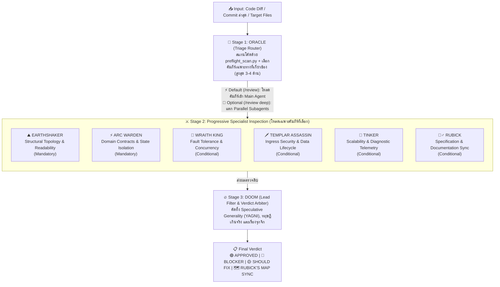
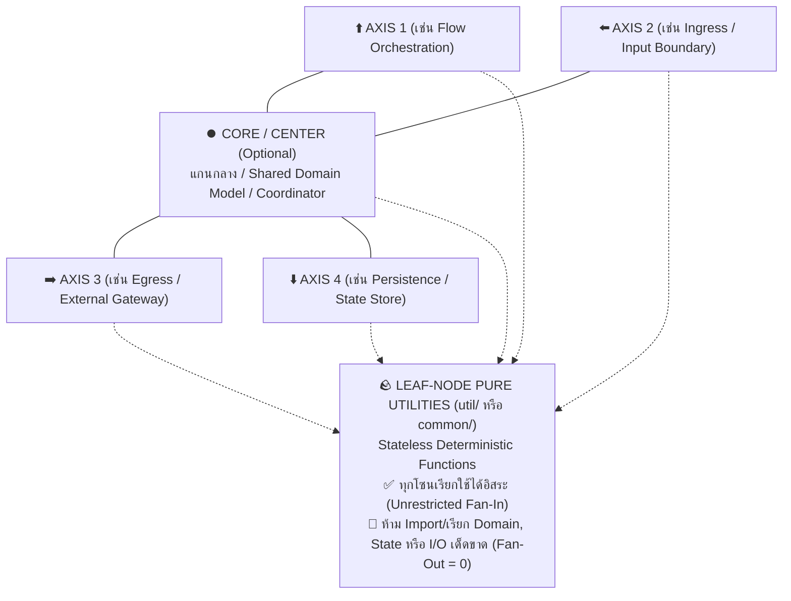

# 🏰 Defense of the Code (`defense-of-the-code`)

> **Progressive Software Architecture & Code Review Skill สำหรับ Google Antigravity**  
> ดำเนินการภายใต้ปรัชญา **ทางสายกลาง (The Middle Path — Proportional Complexity)** ผสานหลัก **ทฤษฎีกราฟ การแยกส่วนโมดูลเชิงตั้งฉาก และการตัดตอนสถานะ (Graph Topology, Orthogonal Decomposition & State Isolation)** เข้ากับระบบ **Progressive Disclosure** ที่เลือกโหลดเฉพาะคัมภีร์ผู้เชี่ยวชาญที่เกี่ยวข้อง และคัดกรองความเห็นขยะรวมถึงข้อเรียกร้องที่สร้าง Churn สูงในโค้ดเดิม (High-Churn Brownfield Demands) ทิ้งอย่างเด็ดขาด

---

## 🎯 แนวคิดการออกแบบ (Build Skills, Not Agents)

ปัญหาคลาสสิกของการใช้ AI ช่วยออกแบบระบบหรือรีวิวโค้ด คือ:
1. **ถ้ายัดทุกกฎใส่ Prompt เดียวตลอดเวลา:** Context บวม เปลือง Token และ AI โฟกัสหลุด
2. **ถ้าสร้างแยกเป็นหลาย Custom Agents ถาวร:** คุยต่อกันไม่รู้เรื่อง บริบทตกหล่น (Context Loss) และเสียเวลาสลับตัว
3. **ถ้าไม่มีตัวกรองขั้นสุดท้าย:** AI มักพยายาม *"เค้นหาเรื่องมาติให้ได้"* จนเกิดความเห็นขยะ (Nitpicking), แนะนำ Design Pattern ท่ายากเกินความจำเป็น (Speculative Generality / YAGNI Violations), หรือยกกรณีสมมติที่ไม่มีโอกาสเกิดจริง

**`defense-of-the-code`** ใช้สถาปัตยกรรม **3-Stage Progressive Pipeline**: ให้ Main Agent ตัวเดียวที่รู้บริบทงานครบ 100% ทำหน้าที่คัดกรอง (`ORACLE`), เลือกเปิดอ่านเฉพาะคัมภีร์เฉพาะทางที่เกี่ยวข้อง (`references/02..07`), และกรองความเห็นขยะทิ้ง (`DOOM`):



---

## 📜 THE ANCIENTS — 7 หลักการสถาปัตยกรรมและวิศวกรรมซอฟต์แวร์

รายละเอียดฉบับเต็มอยู่ใน [`references/00-the-ancients-core-laws.md`](./references/00-the-ancients-core-laws.md):

### ⚖️ ปรัชญาแกนกลาง: ทางสายกลาง (The Middle Path — Proportional Engineering)
ความสมบูรณ์แบบทางสถาปัตยกรรมดำเนินตาม **ทางสายกลาง (The Middle Path)** โดยปรับความลึกของโครงสร้างให้สมส่วนกับความซับซ้อนที่แท้จริงของโจทย์ (Essential Domain Complexity):
* **ปฏิเสธ Under-Engineering แบบมักง่าย:** ไม่เขียนโค้ดทางลัดที่เปราะบาง (Spaghetti Code), ไม่สร้างผลข้างเคียงที่ควบคุมไม่ได้ (Unconstrained Side Effects), ไม่สุมตรรกะไว้ในจุดเดียว และไม่ผูกมัดสถานะข้ามเวลา (Temporal Coupling) แล้วอ้างว่า "เขียนง่ายๆ"
* **ปฏิเสธ Over-Engineering แบบเพ้อฝัน (YAGNI):** ไม่สร้าง Abstraction ซ้อนหลายชั้นโดยไม่จำเป็น, ไม่สร้าง Generic Interfaces เผื่ออนาคตที่ยังมาไม่ถึง, ไม่เพิ่ม Config หรือ Indirection ที่ซับซ้อนเกินจริง
* **The Pragmatic Golden Mean:** สร้างโครงสร้างที่เพรียวลมและเรียบง่ายที่สุดเท่าที่ยังการันตีความถูกต้องเชิงคณิตศาสตร์ (Acyclic DAG), มีขอบเขตการตัดตอนสถานะชัดเจน (State Isolation) และแยกทดสอบแบบ Unit Test ได้จริง

### 1. 🧭 Orthogonal Decomposition (4-Axis + Core Partitioning)
ห้ามเทรวมตรรกะทั้งหมดลงใน `Service` ก้อนเดียว (Monolithic Service) ให้แยกส่วนรับผิดชอบออกเป็นแกนหน้าที่ที่ตั้งฉากต่อกัน (**ไม่เกิน 4 แกนรอบข้าง + 1 แกนกลาง `Core/Center`** ตามแนวคิดปุ่มควบคุม D-Pad):
* **High Cohesion, Single Axis of Responsibility:** แต่ละแกนทำหน้าที่อะไรปรับเปลี่ยนได้ตามบริบทของโดเมนนั้นๆ (เช่น Flow Orchestration, Ingress, Egress, Persistence หรือแยกตาม Sub-domain)
* **Strict Boundary:** เมื่อแบ่งโซนแล้ว แต่ละโซนต้องทำงานอยู่ในระดับนามธรรม (Abstraction Level) ของตัวเอง ห้ามเขียนโค้ดข้ามบทบาทปนกัน
* **Brownfield Constructor Guard (เกราะป้องกัน Constructor แตกในระบบเดิม):** เมื่อต่อเติมฟีเจอร์ย่อยในระบบเดิมที่มีการทำ Dependency Injection (เช่น Guice `@Inject()` ใน Scala Play หรือ Spring) ให้เพิ่มเมธอดลงใน Collaborator เดิมในแกนที่ตรงกัน แทนที่จะสร้างคลาสใหม่มาฉีดเข้า Constructor กลาง เพราะการเปลี่ยน Signature ของ Constructor ใน Service หลักจะทำให้ Unit Test เดิม (`*Spec`) พังทั้งโปรเจกต์



### 2. 🕸️ Acyclic Call Topology & Dominator Enforcement (Strict DAG)
* โครงสร้างการเรียกข้ามโมดูลต้องเป็น **Directed Acyclic Graph (DAG)** ห้ามเกิด Circular Dependency (`A -> B -> A`)
* **Dominator Vertex Enforcement:** โมดูลชั้นบนห้ามลัดวงจรข้ามชั้นควบคุมตรงกลาง (Dominator Node) ไปเรียกชั้นล่างโดยตรง เพื่อให้มีจุดศูนย์กลางเดียวสำหรับทำ Policy Enforcement, Instrumentation และ Test Doubles

### 3. 🪨 Leaf-Node Pure Utilities (`Fan-Out = 0` Invariant)
* ฟังก์ชันช่วยเหลือที่ไร้สถานะ (Pure Stateless Functions) ให้จัดไว้ในชั้น **Leaf Utility** (`util/`, `common/`)
* **Unrestricted Fan-In (`In-Degree ≥ 0`):** อนุญาตให้ทุกโซนเรียกใช้ Leaf Utility ได้โดยตรงโดยไม่ถือว่าผิดกฎข้อ 2
* **Zero Fan-Out (`Out-Degree = 0`):** ห้ามไฟล์ใน Utility เรียกใช้หรือ Import `Service`, `Controller`, `Repository`, หรือ `State` ใดๆ เด็ดขาด

### 4. 🧪 Subgraph State Isolation & Explicit Context Injection
* **Zero Sequential Coupling:** ห้ามโมดูลหรือหน้าจอใดๆ พึ่งพา Hidden Global State หรือผลข้างเคียงที่ถูกทิ้งไว้จากขั้นตอนก่อนหน้า (`Steps 1..N-1`)
* **Explicit Context Injection:** ทุกคอมโพเนนต์ต้องประกาศรับ State Context ที่ต้องใช้เข้ามาอย่างชัดเจนที่อินเทอร์เฟซขาเข้า เพื่อให้สามารถตัดโหนดที่ $N$ ออกมาเขียน Unit Test หรือรันแยกเดี่ยวได้ทันทีโดยไม่ต้องรันขั้นตอนที่ `1..N-1` นำมาก่อน

### 5. ✂️ Lexical Conciseness (~2–3 Lexemes) & Idiomatic Casing Hierarchy
* **ความกระชับของชื่อ (~2–3 คำหลัก):** ตั้งชื่อฟังก์ชัน เมธอด และตัวแปรให้สื่อความหมายจบภายในประมาณ 2–3 คำหลัก (ไม่นับ Prefix มาตรฐานอย่าง `get_`, `is_`, `on_`) โดยใช้เป็น **ตัวตรวจจับกลิ่นโค้ด (SRP Smell Detector)** ไม่ใช่การล็อกจำนวนคำตายตัว — ถ้าชื่อยาวเพราะฟังก์ชันทำหลายอย่างปนกันให้แยกฟังก์ชัน แต่ถ้าจำเป็นต้องใช้ 4 คำเพื่อความชัดเจนทางธุรกิจ (หรือชื่อ Unit Test) สามารถใช้ได้
* **ลำดับความสำคัญของรูปแบบตัวอักษร (Casing Precedence):**
  1. **Local Module Convention First (Law 7):** ยึดตามรูปแบบที่ใช้กันอยู่แล้วในไฟล์หรือโมดูลนั้นเป็นหลัก
  2. **Language / Ecosystem Idiom Second:** ยึดตามมาตรฐานของภาษานั้นๆ (เช่น `camelCase` ใน Java/TS/Dart/Go, `PascalCase` ใน C#, `snake_case` ใน Python/Rust/C/SQL)
  3. **Favor `snake_case` When Unconstrained:** เมื่อไม่มีข้อบังคับของภาษา ให้ใช้ `snake_case` เป็นค่าเริ่มต้นเพื่อความชัดเจนในการแยกคำ

### 6. 📝 Linear Execution Ordering (Stepdown Rule) & Structural Symmetry
* **Top-Down Stepdown Rule:** วาง Public Entry/Orchestrator Method ไว้บนสุดของไฟล์หรือคลาส แล้วเรียง Private Helper Methods ข้างล่างตามลำดับเวลาที่ถูกเรียก `1 -> 2 -> 3` เพื่อให้อ่านไล่จากบนลงล่างได้เป็นเส้นตรงโดยไม่ต้องกระโดดข้ามบรรทัด (**บังคับใช้กับคลาสและเมธอดที่เขียนขึ้นใหม่เท่านั้น ห้ามสั่งสลับลำดับเมธอดเดิมในไฟล์เก่าที่ไม่ได้ถูกแตะ**)
* **Cross-Layer Structural Symmetry:** เมื่อชั้นบนส่งหรือ Map ข้อมูล `A..Z` ลงไปชั้นล่าง ชั้นล่างต้องประกาศและประมวลผล `A..Z` ในลำดับเดียวกันเป๊ะ เพื่อให้ตรวจพบฟิลด์ที่ตกหล่นได้ทันที (**บังคับใช้เฉพาะกับ Type หรือ Data Structure ที่สร้างขึ้นใหม่ ห้ามสั่งสลับฟิลด์ของ `case class`/DTO/struct เดิม** เพราะจะทำให้ Positional Constructor พังและทำให้ Git Diff บวมโดยเปล่าประโยชน์)

### 7. 🦎 Contextual Stylistic Homogeneity
* โค้ดที่เพิ่มหรือแก้ไขในไฟล์เดิม ต้องคงระดับนามธรรม (Abstraction Granularity) คลังคำศัพท์ และรูปแบบการจัดการ Error ให้เป็นเนื้อเดียวกับเมธอดรอบข้าง

---

## ⚔️ ทำเนียบมุมมองผู้เชี่ยวชาญ (Specialist Lenses)

| ขั้นตอน | รหัสผู้เชี่ยวชาญ | ขอบเขตการตรวจสอบ | เงื่อนไขการเปิดใช้ | เอกสารอ้างอิง |
| :--- | :--- | :--- | :--- | :--- |
| **Stage 1** | 🔮 **ORACLE** | **Triage Router** | รันทุกครั้งเพื่อสแกน Diff ด้วย `preflight_scan.py` และเลือกคัมภีร์ที่เกี่ยวข้อง (สูงสุด 3–4 ด้าน) | [`01-oracle-triage-router.md`](./references/01-oracle-triage-router.md) |
| **Stage 2** | ⛰️ **EARTHSHAKER** | **Structural Topology & Readability** | **บังคับใช้ทุกครั้ง (Baseline)** — ตรวจการแยกส่วนโมดูล, กราฟ DAG, Leaf Utility, ความกระชับของชื่อ, Stepdown Rule และความกลมกลืนของโค้ด | [`02-earthshaker-topology-style.md`](./references/02-earthshaker-topology-style.md) |
| **Stage 2** | ⚡ **ARC WARDEN** | **Domain Contracts & State Isolation** | **บังคับใช้ทุกครั้ง (Baseline)** — ตรวจความถูกต้องของตรรกะ, Schema-First Modeling และ **Subgraph State Isolation** | [`03-arc-warden-contract-state.md`](./references/03-arc-warden-contract-state.md) |
| **Stage 2** | 👑 **WRAITH KING** | **Fault Tolerance & Concurrency** | เปิดใช้เมื่อแตะ `async/await`, Thread, Queue, DB Transaction, Batch/Retry หรือ External I/O | [`04-wraith-king-fault-concurrency.md`](./references/04-wraith-king-fault-concurrency.md) |
| **Stage 2** | 🗡️ **TEMPLAR ASSASSIN** | **Ingress Security & Data Lifecycle** | เปิดใช้เมื่อแตะ Ingress Controller, AuthN/AuthZ, Raw Query/Command หรือข้อมูลลับ (PIN, Key, Token, PII) | [`05-templar-security-hygiene.md`](./references/05-templar-security-hygiene.md) |
| **Stage 2** | 🚀 **TINKER** | **Scalability & Diagnostic Telemetry** | เปิดใช้เมื่อแตะ DB Query, Loop ข้อมูลชุดใหญ่, Stream/Batch หรือจุดตัดเลเยอร์ที่ต้องมี Structured Log สำหรับวิเคราะห์ปัญหาบน Production | [`06-tinker-scale-trace.md`](./references/06-tinker-scale-trace.md) |
| **Stage 2** | 🧙‍♂️ **RUBICK** | **Specification & Documentation Sync** | เปิดใช้เมื่อแก้ API Schema/DTO, DB Migration, Env/Config หรือ Flow หลัก (รันคู่กับ `doc_drift_finder.py`) | [`07-rubick-spec-doc-sync.md`](./references/07-rubick-spec-doc-sync.md) |
| **Stage 3** | 🔥 **DOOM** | **Lead Filter & Verdict Arbiter** | รันปิดท้ายทุกครั้ง — ตัดความเห็นขยะ, Speculative Generality (YAGNI), กรณีสมมติเกินจริง, Pedantic Casing Nitpicks และ High-Churn Brownfield Demands (เช่น ห้ามสั่งรื้อทั้งบล็อก `match`/`if-else` เก่าเมื่อเป็นเพียง surgical branch ย่อย) พร้อมยุบรวมประเด็นซ้ำ | [`08-doom-lead-filter.md`](./references/08-doom-lead-filter.md) |

---

## 📂 โครงสร้างไฟล์ใน Repository

```text
defense-of-the-code/
├── SKILL.md                                      # ไฟล์คำสั่งหลักสำหรับ Antigravity Agent
├── plugin.json                                   # Plugin Manifest สำหรับ Antigravity Plugin Manager / Marketplace
├── install.sh                                    # สคริปต์ One-Liner ติดตั้งและอัปเดตอัตโนมัติ
├── uninstall.sh                                  # สคริปต์ถอนการติดตั้งอย่างปลอดภัย
├── README.md                                     # เอกสารคู่มือการใช้งานสำหรับมนุษย์ (ไฟล์นี้)
├── references/                                   # คัมภีร์แยกตามบทบาท (Progressive Disclosure)
│   ├── 00-the-ancients-core-laws.md              # หลักการสถาปัตยกรรมและวิศวกรรมซอฟต์แวร์ 7 ข้อ
│   ├── 01-oracle-triage-router.md                # Stage 1: เกณฑ์การคัดกรองและเลือกคัมภีร์เฉพาะทาง
│   ├── 02-earthshaker-topology-style.md          # Stage 2: โครงสร้างกราฟ การแยกโมดูล และการจัดลำดับโค้ด
│   ├── 03-arc-warden-contract-state.md           # Stage 2: ความถูกต้องของข้อมูลและ Subgraph State Isolation
│   ├── 04-wraith-king-fault-concurrency.md       # Stage 2: ความทนทานต่อความล้มเหลวและ Concurrency
│   ├── 05-templar-security-hygiene.md            # Stage 2: ความปลอดภัยขาเข้าและวงจรชีวิตข้อมูลสำคัญ
│   ├── 06-tinker-scale-trace.md                  # Stage 2: ประสิทธิภาพและ Diagnostic Telemetry
│   ├── 07-rubick-spec-doc-sync.md                # Stage 2: การซิงค์เอกสาร Spec/Config และ High-Signal Comments
│   └── 08-doom-lead-filter.md                    # Stage 3: กฎการกรองความเห็นขยะและฟอร์แมตสรุปผล
└── scripts/                                      # สคริปต์ช่วยสแกนอัตโนมัติ
    ├── preflight_scan.py                         # ตรวจจับชื่อฟังก์ชันยาวเกินเกณฑ์และ Leaf Utility Fan-Out > 0
    └── doc_drift_finder.py                       # กวาดหาไฟล์ Spec/Doc/Config ในโปรเจกต์ให้ RUBICK
```

---

## 🚀 วิธีติดตั้งและถอนการติดตั้ง (Installation & Uninstallation)

### ⚡ แบบที่ 1: One-Liner Quick Install (ง่ายและเร็วที่สุด สำหรับลงเครื่องใหม่)
เปิด Terminal บนเครื่องที่ใช้งาน Antigravity แล้วรันคำสั่งเดียวจบ:

```bash
curl -fsSL https://raw.githubusercontent.com/roticagas/defense-of-the-code/main/install.sh | bash
```

> **หมายเหตุ:** หากเคยติดตั้งไว้แล้ว การรันคำสั่งเดิมซ้ำจะทำการ `git pull` อัปเดตเป็นเวอร์ชันล่าสุดให้อัตโนมัติ

---

### 🛠️ แบบที่ 2: ติดตั้งด้วยตัวเองหรือเลือกโหมด (Manual / Flexible Install)

#### 1. ติดตั้งระดับ Global (ใช้ได้กับทุกโปรเจกต์ในเครื่อง)
* **กรณีมีโฟลเดอร์ Repo ในเครื่องอยู่แล้ว:**
  ```bash
  ./install.sh                # สร้าง symlink เข้า ~/.gemini/config/skills/ อัตโนมัติ
  ```
* **หรือสร้าง Symlink ด้วยตัวเอง:**
  ```bash
  mkdir -p ~/.gemini/config/skills
  ln -sfn /path/to/defense-of-the-code ~/.gemini/config/skills/defense-of-the-code
  ```
* **ถอนการติดตั้ง:**
  ```bash
  ./uninstall.sh              # หรือรัน: rm ~/.gemini/config/skills/defense-of-the-code
  ```

#### 2. ติดตั้งเฉพาะโปรเจกต์ (Workspace-Specific)
* **ใช้สคริปต์ระบุโฟลเดอร์โปรเจกต์:**
  ```bash
  ./install.sh --workspace /path/to/your-project
  ```
* **หรือแชร์ผ่าน Git Submodule ในทีม:**
  ```bash
  cd /path/to/your-project
  mkdir -p .agents/skills
  git submodule add https://github.com/roticagas/defense-of-the-code.git .agents/skills/defense-of-the-code
  ```

#### 3. ติดตั้งในฐานะ Plugin Bundle (รองรับการเปิด/ปิดผ่าน UI Plugin Manager)
* **ใช้สคริปต์ติดตั้ง:**
  ```bash
  ./install.sh --plugin       # ติดตั้งไปยัง ~/.gemini/config/plugins/defense-of-the-code
  ```
* **ถอนการติดตั้ง:**
  ```bash
  ./uninstall.sh --plugin
  ```

---

## 💡 วิธีเรียกใช้งาน (Usage)

> **🔒 Explicit Invocation Rule:** Skill นี้ถูกออกแบบให้ **ไม่เปิดทำงานอัตโนมัติ** ในระหว่างการสนทนาทั่วไป การปรึกษา feasibility หรือการพูดคุยทางเทคนิคทั่วไป เพื่อให้อิสระในการแลกเปลี่ยนไอเดียอย่างเป็นธรรมชาติ Skill จะทำงานก็ต่อเมื่อผู้ใช้เรียกใช้ผ่านคำสั่ง `/defense-of-the-code` (หรือคำสั่งย่อ `/dotc`, `/blueprint`, `/review`, `/review deep`) เท่านั้น

### 🗣️ Natural Language Intent Routing (สั่งงานด้วยภาษาพูด)
สามารถเรียก `/defense-of-the-code` (หรือ `/dotc`) ตามด้วยข้อความภาษาธรรมชาติเพื่อเลือกโหมดได้ทันที:

```text
/defense-of-the-code ช่วยออกแบบฟีเจอร์คำนวณภาษีต่อจากที่คุยกันเมื่อกี้หน่อย      --> Mode A (Blueprint)
/defense-of-the-code รีวิวโค้ดที่เพิ่งแก้ใน commit ล่าสุดให้หน่อย                 --> Mode B (Standard Review)
/defense-of-the-code รีวิวละเอียดแบบเข้มๆ ขอ fresh eyes                         --> Mode B (Deep Review)

# หรือพิมพ์ย่อด้วย /dotc:
/dotc ช่วยออกแบบฟีเจอร์...
/dotc รีวิวโค้ดให้หน่อย
```

---

### 1. โหมดวางโครงสร้างสถาปัตยกรรม (Mode A: Architectural Blueprint)
> เรียกด้วย: `/defense-of-the-code ช่วยออกแบบ...`, `/dotc ช่วยออกแบบ...`, `/defense-of-the-code วางโครงสร้างต่อจากที่คุย` หรือพิมพ์ย่อ `/blueprint`

* **Preserve Context & Layer On Prior Exploration:** หากในการสนทนาก่อนหน้ามีการวิเคราะห์ feasibility, payload API, ข้อจำกัด infra หรือ root-cause มาแล้ว Agent จะนำข้อมูลเชิงลึกเหล่านั้นมาสังเคราะห์ลงใน Blueprint ทันที โดยไม่เริ่มถามใหม่จากศูนย์
* **Scale to Feature Size (YAGNI First):** ปรับขนาดตามงานจริง หากเป็นเพียงการเพิ่มเมธอดหรือ endpoint ย่อย จะระบุตำแหน่งไฟล์ในบรรทัดเดียว ไม่สร้างแกนโมดูลหรือเลเยอร์ปลอมขึ้นมาให้รก
* **Brownfield Minimal-Churn:** ในโปรเจกต์เดิม จะเลือกเพิ่มเมธอดใน Collaborator เดิมที่มีอยู่แล้วเพื่อเลี่ยงการแก้ Constructor ที่กระทบ Unit Test ทั้งระบบ

Agent จะนำเสนอโครงสร้าง 3 ส่วนก่อนเริ่มเขียนโค้ดจริง:
1. **🧭 Orthogonal Module Partitioning:** แยกความรับผิดชอบออกเป็นแกนหน้าที่ (`4-Axis + Core` และ `Leaf-Node Utilities`)
2. **📝 Linear Stepdown Skeleton:** โครงเมธอดเรียงจากบนลงล่าง `1 -> 2 -> 3` ด้วยชื่อที่กระชับตามลำดับศักดิ์ของภาษา
3. **🧪 Subgraph State Isolation Contract:** ระบุ State Context ที่ต้องรับเข้ามาเพื่อให้ทดสอบโหนดนี้แยกเดี่ยวได้ทันที

---

### 2. โหมดตรวจรีวิวโค้ด (Mode B: 3-Stage Progressive Review)
> **Strict Read-Only Guard:** ระหว่างการรีวิว Agent จะอ่านโค้ดอย่างเดียวเท่านั้น และ **ไม่มีสิทธิ์แก้ไขไฟล์ในโปรเจกต์โดยพลการ** จนกว่าผู้ใช้จะยืนยันให้นำข้อเสนอแนะไปปรับใช้

#### ⚡ แบบมาตรฐาน (Standard Review — In-Context Progressive Skill):
> เรียกด้วย: `/defense-of-the-code ช่วยรีวิวโค้ดให้หน่อย`, `/dotc รีวิวโค้ดให้หน่อย`, `/defense-of-the-code เช็ค PR นี้ที` หรือพิมพ์ย่อ `/review`

* ทำงานรวดเร็วและคงบริบทการพูดคุยในห้องเดิมครบ 100%
* **`ORACLE`** รัน [`scripts/preflight_scan.py`](./scripts/preflight_scan.py) และเลือกคัมภีร์ที่เกี่ยวข้อง (สูงสุด 3–4 ด้าน)
* **Main Agent** โหลดเฉพาะไฟล์ `references/` ที่เกี่ยวข้องเข้ามาตรวจสอบ แล้วส่งผลผ่าน **`DOOM`** เพื่อตัดความเห็นขยะทิ้ง

#### 🔬 แบบละเอียดลึกซึ้ง (Deep / Fresh-Eyes Review — Parallel Subagents):
> เรียกด้วย: `/defense-of-the-code รีวิวละเอียด`, `/dotc รีวิวละเอียด`, `/defense-of-the-code รีวิวแบบเข้มๆ ทุกจุด`, `/defense-of-the-code ขอ fresh eyes` หรือพิมพ์ย่อ `/review deep`

* แยก **Parallel Subagents (`invoke_subagent`)** ประจำแต่ละ Lens ในห้องทำงานอิสระ ป้องกัน Bias จากการเขียนโค้ดในเซสชันเดิม
* ดัมป์ scoped diff ไปยัง scratch directory แล้วส่งให้แต่ละ Subagent ตรวจสอบเฉพาะบรรทัดที่เปลี่ยนแปลง
* รวบรวมผลตรวจและผ่านตัวกรอง **`DOOM`** เพื่อออก Final Verdict เดียวกัน
