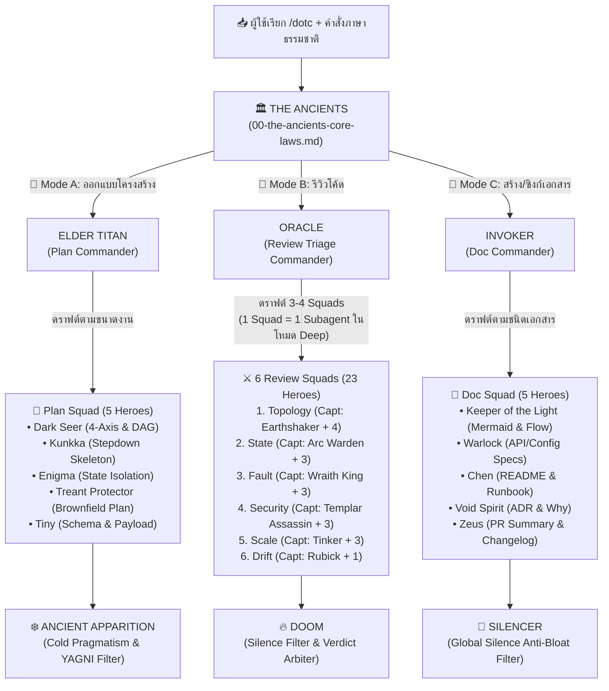

# 🏰 Defense of the Code (`defense-of-the-code`)

> **Multi-Commander & Squad Software Architecture, Code Review & Documentation Skill สำหรับ Google Antigravity**  
> ดำเนินการภายใต้ปรัชญา **ทางสายกลาง (The Middle Path — Proportional Complexity)** ผสานหลัก **ทฤษฎีกราฟ การแยกส่วนโมดูลเชิงตั้งฉาก และการตัดตอนสถานะ (Graph Topology, Orthogonal Decomposition & State Isolation)** เข้ากับระบบ **Multi-Commander & Squad Progressive Disclosure (`1 Hero = 1 File`)** ที่แยกแม่ทัพและทีมฮีโร่ออกเป็น **3 โหมดหลัก (Plan / Review / Documentation)** โดยไม่มีฮีโร่ซ้ำกันเลย (รวม 33 ฮีโร่)

---

## 🎯 แนวคิดการออกแบบ (Symmetrical Multi-Commander & Squad Pipeline)

ปัญหาคลาสสิกของการใช้ AI ช่วยออกแบบระบบ รีวิวโค้ด หรือเขียนเอกสาร คือ:
1. **ถ้ายัดทุกกฎใส่ Prompt เดียวตลอดเวลา:** Context บวม เปลือง Token และ AI โฟกัสหลุด
2. **ถ้าซอย Subagent แยกทุกกฎย่อย:** เวลาตรวจโค้ดรอบนึงต้องแตก 15–20 Subagent เปลืองค่าอ่าน Diff ซ้ำซ้อน
3. **ถ้าปนบทบาทคนตรวจโค้ด (Read-only) กับคนเขียนเอกสาร (Writer):** คำสั่งในไฟล์เดียวกันตีกันเอง
4. **ถ้าไม่มีตัวกรองขั้นสุดท้าย:** AI มักเค้นหาเรื่องจุกจิกมาติ (Nitpicking), แนะนำท่ายากเกินความจำเป็น (YAGNI), หรือเขียนเอกสารน้ำท่วมทุ่ง

**`defense-of-the-code` (v2.0)** จึงจัดโครงสร้างแบบ **Symmetrical 3-Stage Squad Pipeline** ในทุกโหมด:
> **แม่ทัพเปิดเกม (Mode Commander) $\rightarrow$ ทีมผู้เชี่ยวชาญเฉพาะทาง (`1 Hero = 1 File`) $\rightarrow$ ผู้กรองปิดท้าย (Final Filter)**



---

## 📜 THE ANCIENTS — 7 หลักการสถาปัตยกรรมและวิศวกรรมซอฟต์แวร์

รายละเอียดฉบับเต็มอยู่ใน [`references/00-the-ancients-core-laws.md`](./references/00-the-ancients-core-laws.md):

1. **🧭 Law 1 — Orthogonal Decomposition (4-Axis + Core & Brownfield Constructor Guard):** แยกส่วนรับผิดชอบออกเป็นแกนหน้าที่ที่ตั้งฉากกัน (ไม่เกิน 4 แกนรอบข้าง + 1 แกนกลาง) และเมื่อต่อเติมระบบเดิม (เช่น Guice `@Inject()` ใน Scala Play) ให้เพิ่มเมธอดใน Collaborator เดิมในแกนที่ตรงกันเพื่อไม่ให้ Constructor เปลี่ยนจน Unit Test (`*Spec`) พังทั้งระบบ
2. **🕸️ Law 2 — Acyclic Call Topology & Dominator Enforcement (Strict DAG):** ห้ามเกิด Circular Dependency (`A -> B -> A`) และห้ามลัดวงจรข้าม Dominator Gatekeeper
3. **🪨 Law 3 — Leaf-Node Pure Utilities (`Fan-Out = 0` Invariant):** ฟังก์ชันใน `util/` หรือ `common/` ต้องไร้สถานะ 100% ทุกชั้นเรียกใช้ได้อิสระ (`Unrestricted Fan-In`) แต่ห้าม Import หรือเรียก Service, Controller หรือ Repository เด็ดขาด (`Out-Degree = 0`)
4. **🧪 Law 4 — Subgraph State Isolation & Explicit Context Injection:** ทุกคอมโพเนนต์ต้องรับ State Context เข้ามาอย่างชัดเจนที่อินเทอร์เฟซขาเข้า เพื่อให้ตัดโหนดที่ $N$ ออกมาเขียน Unit Test หรือรันแยกเดี่ยวได้โดยไม่ต้องรันขั้นตอนที่ `1..N-1`
5. **✂️ Law 5 — Lexical Conciseness (~2–3 Lexemes) & Idiomatic Casing Hierarchy:** ตั้งชื่อให้กระชับภายใน ~2–3 คำหลัก (ใช้เป็นตัวตรวจจับกลิ่น SRP) และยึดลำดับตัวอักษรตาม **(1) สไตล์เดิมของไฟล์นั้น $\rightarrow$ (2) มาตรฐานของภาษา $\rightarrow$ (3) `snake_case`**
6. **📝 Law 6 — Linear Execution Ordering (Stepdown Rule) & Structural Symmetry:** เรียงเมธอดที่เขียนใหม่จาก `public` ลงมา `private` (`1 -> 2 -> 3`) และเรียงฟิลด์ใน Type ที่สร้างใหม่ให้สมมาตรกันข้ามเลเยอร์ (**ห้ามสั่งสลับลำดับเมธอดเดิมหรือฟิลด์ของ `case class`/DTO เดิมในไฟล์เก่า**)
7. **🦎 Law 7 — Contextual Stylistic Homogeneity & Surgical Edits:** โค้ดที่แก้ในไฟล์เดิมต้องกลมกลืนกับเมธอดรอบข้าง และแก้เฉพาะจุดแบบ Surgical Edit

---

## ⚔️ ทำเนียบแม่ทัพและทีมฮีโร่ทั้ง 3 โหมด (`1 Hero = 1 File`)

### 🔨 Mode A: Architectural Blueprint (ออกแบบและวางแผนก่อนเขียนโค้ด)
- **แม่ทัพเปิดเกม:** 🔨 **`ELDER TITAN`** ([`mode-a-elder-titan.md`](./references/commanders/mode-a-elder-titan.md))
- **ผู้กรองแผนปิดท้าย:** ❄️ **`ANCIENT APPARITION`** ([`mode-a-ancient-apparition.md`](./references/commanders/mode-a-ancient-apparition.md))

| ฮีโร่ (`plan-squad/`) | บทบาทในการวางแผน | เอกสารอ้างอิง |
| :--- | :--- | :--- |
| 🌀 **DARK SEER** | วางผัง 4-Axis Partitioning, กราฟ DAG และการแยก Pure Leaf Utilities (`Fan-Out = 0`) | [`dark-seer.md`](./references/heroes/plan-squad/dark-seer.md) |
| ⚓ **KUNKKA** | ร่างโครง Linear Stepdown Skeleton (`1 -> 2 -> 3`) และการตั้งชื่อกระชับ ~2–3 คำ | [`kunkka.md`](./references/heroes/plan-squad/kunkka.md) |
| 🌌 **ENIGMA** | กำหนดสัญญา Subgraph State Isolation และการออกแบบให้ทำ Unit Test แยกส่วนได้ | [`enigma.md`](./references/heroes/plan-squad/enigma.md) |
| 🌳 **TREANT PROTECTOR** | วางแผนผ่าตัดโค้ดเก่า (Brownfield Surgical Plan) ป้องกัน Constructor และ `*Spec` พัง | [`treant-protector.md`](./references/heroes/plan-squad/treant-protector.md) |
| 🪨 **TINY** | ออกแบบ Schema-First Data Model, DTO/`case class` และความสมมาตรของข้อมูลข้ามเลเยอร์ | [`tiny.md`](./references/heroes/plan-squad/tiny.md) |

---

### 🔮 Mode B: Progressive Code Review (ตรวจโค้ด 3 ด่าน — Read-Only)
- **แม่ทัพคัดกรอง (Stage 1):** 🔮 **`ORACLE`** ([`mode-b-oracle.md`](./references/commanders/mode-b-oracle.md)) — รัน `preflight_scan.py` และดราฟต์ **3–4 Squads** (พร้อมคัดเฉพาะฮีโร่ที่เกี่ยวข้องในแต่ละทีม)
- **ผู้ตัดสินปิดท้าย (Stage 3):** 🔥 **`DOOM`** ([`mode-b-doom.md`](./references/commanders/mode-b-doom.md)) — ตัด Nitpick, YAGNI และ High-Churn Brownfield Demands ทิ้ง

| Squad (1 Squad = 1 Subagent ในโหมด Deep) | กัปตันทีม (Captain) | ลูกทีมในสังกัด (`1 Hero = 1 File`) |
| :--- | :--- | :--- |
| **1. Topology & Style** (`squad-1-topology/`) | ⛰️ **EARTHSHAKER** *(4-Axis & DAG)* | • 🪚 **TIMBERSAW** *(Leaf Utility `Fan-Out = 0`)*<br>• 🦏 **MAGNUS** *(Stepdown & Symmetry)*<br>• 🗡️ **SVEN** *(~2–3 Lexeme Naming & Casing)*<br>• 🌊 **MORPHLING** *(Brownfield Guard & Style)* |
| **2. State & Contract** (`squad-2-state/`) | ⚡ **ARC WARDEN** *(State Isolation)* | • 🐍 **MEDUSA** *(Immutability & Domain Model)*<br>• ⏳ **FACELESS VOID** *(Boundary & Null/Option Safety)*<br>• 🍺 **BREWMASTER** *(Backward Compatibility)* |
| **3. Fault & Concurrency** (`squad-3-fault/`) | 👑 **WRAITH KING** *(Fault & Atomicity)* | • 🪲 **WEAVER** *(Race Conditions, Async & Idempotency)*<br>• 🛡️ **ABADDON** *(Timeouts & Backpressure)*<br>• 🔥 **PHOENIX** *(Resource Lifecycle & Leak Prevention)* |
| **4. Security & Hygiene** (`squad-4-security/`) | 🌸 **TEMPLAR ASSASSIN** *(Ingress & Injection)* | • 🎯 **BOUNTY HUNTER** *(AuthN/AuthZ & IDOR)*<br>• 👹 **SHADOW FIEND** *(Secrets & PII Sink Masking)*<br>• 🦂 **NYX ASSASSIN** *(SSRF & Deserialization)* |
| **5. Scale & Telemetry** (`squad-5-scale/`) | 🚀 **TINKER** *(N+1 & Query Scale)* | • ⚙️ **CLOCKWERK** *(10s Triage Logs & Trace ID)*<br>• 🧪 **ALCHEMIST** *(Memory Footprint & Streaming)*<br>• 🚁 **GYROCOPTER** *(Pagination Caps & Cache Hygiene)* |
| **6. Spec & Drift Radar** (`squad-6-drift/`) | 🧙‍♂️ **RUBICK** *(Spec/Config Drift)* | • 🖌️ **GRIMSTROKE** *(Stale Comment Purge & High-Signal Why)* |

---

### 📖 Mode C: Documentation & Knowledge Sync (สร้างและอัปเดตเอกสารทางเทคนิค)
- **แม่ทัพเปิดเกม:** 📖 **`INVOKER`** ([`mode-c-invoker.md`](./references/commanders/mode-c-invoker.md))
- **ผู้ตัดน้ำท่วมทุ่งปิดท้าย:** 🤫 **`SILENCER`** ([`mode-c-silencer.md`](./references/commanders/mode-c-silencer.md)) — บังคับใช้ *Global Silence* ตัดเกริ่นนำขยะ เปลี่ยนข้อความยาวๆ เป็นตารางและไดอะแกรม Mermaid

| ฮีโร่ (`doc-squad/`) | ชนิดเอกสารที่รับผิดชอบ | เอกสารอ้างอิง |
| :--- | :--- | :--- |
| 💡 **KEEPER OF THE LIGHT** | **`ARCHITECTURE.md` & Mermaid Diagrams:** วาดแผนผังระบบ (DAG, Sequence, State Machine) และสรุปขอบเขตโมดูล | [`keeper-of-the-light.md`](./references/heroes/doc-squad/keeper-of-the-light.md) |
| 📕 **WARLOCK** | **API Contracts & Config Specs:** เขียนและอัปเดต OpenAPI/Swagger, ตาราง Request/Response/Error และ `.env.example` | [`warlock.md`](./references/heroes/doc-squad/warlock.md) |
| 🦌 **CHEN** | **`README.md` & Operational Runbooks:** เขียนคู่มือ Quickstart, คำสั่ง Build/Run/Test และตาราง Troubleshooting | [`chen.md`](./references/heroes/doc-squad/chen.md) |
| 🟣 **VOID SPIRIT** | **ADR & "Why" Rationales:** เขียน Architecture Decision Records, สรุป Trade-off และ High-Signal *"Why"* Comments | [`void-spirit.md`](./references/heroes/doc-squad/void-spirit.md) |
| ⚡ **ZEUS** | **PR Summary, `CHANGELOG.md` & Migration Guide:** สรุปสิ่งที่เปลี่ยนจาก `git diff`/Branch สำหรับเปิด PR และ Release Notes | [`zeus.md`](./references/heroes/doc-squad/zeus.md) |

---

## 📂 โครงสร้างไฟล์ใน Repository

```text
defense-of-the-code/
├── SKILL.md                                      # ไฟล์คำสั่งหลักและ Intent Router (Mode A / B / C)
├── plugin.json                                   # Plugin Manifest สำหรับ Antigravity
├── install.sh                                    # สคริปต์ติดตั้งและอัปเดตอัตโนมัติ
├── uninstall.sh                                  # สคริปต์ถอนการติดตั้ง
├── README.md                                     # เอกสารคู่มือการใช้งานฉบับเต็ม
├── scripts/
│   ├── preflight_scan.py                         # สแกน git diff, Law 3 Fan-Out และ Law 5 Naming Hints
│   └── doc_drift_finder.py                       # กวาดหาไฟล์ Spec/Doc/Config ในโปรเจกต์
└── references/
    ├── 00-the-ancients-core-laws.md              # กฎเหล็กสูงสุด 7 ข้อ (The Ancients)
    ├── commanders/                               # แม่ทัพเปิดเกม & ผู้กรองปิดท้ายของทั้ง 3 โหมด
    │   ├── mode-a-elder-titan.md
    │   ├── mode-a-ancient-apparition.md
    │   ├── mode-b-oracle.md
    │   ├── mode-b-doom.md
    │   ├── mode-c-invoker.md
    │   └── mode-c-silencer.md
    └── heroes/                                   # คลังฮีโร่แยกไฟล์เดี่ยว (1 Hero = 1 File)
        ├── plan-squad/                           # 🔨 5 ฮีโร่สายวางแผน (Mode A)
        ├── review-squads/                        # 🔮 6 ทีม 21 ฮีโร่สายตรวจโค้ด (Mode B)
        │   ├── squad-1-topology/
        │   ├── squad-2-state/
        │   ├── squad-3-fault/
        │   ├── squad-4-security/
        │   ├── squad-5-scale/
        │   └── squad-6-drift/
        └── doc-squad/                            # 📖 5 ฮีโร่สายเขียนเอกสาร (Mode C)
```

---

## 💡 วิธีเรียกใช้งาน (Usage)

สามารถเรียก `/defense-of-the-code` (หรือพิมพ์ย่อ `/dotc`) ตามด้วยคำสั่งภาษาธรรมชาติได้ทันที:

```text
# 🔨 Mode A: ออกแบบและวางแผนโครงสร้างโค้ด (ELDER TITAN -> Plan Squad -> ANCIENT APPARITION)
/dotc ช่วยออกแบบฟีเจอร์คำนวณภาษีต่อจากที่คุยกันเมื่อกี้หน่อย
/blueprint

# 🔮 Mode B: รีวิวโค้ด (ORACLE -> Review Squads -> DOOM)
/dotc รีวิวโค้ดที่เพิ่งแก้ให้หน่อย                        (⚡ Standard In-Context)
/dotc รีวิวละเอียดแบบเข้มๆ ขอ fresh eyes                 (🔬 Deep Parallel Squad Subagents)
/review
/review deep

# 📖 Mode C: สร้างและอัปเดตเอกสาร (INVOKER -> Doc Squad -> SILENCER)
/dotc ช่วยวาด Mermaid diagram สรุป architecture ของโมดูลนี้ให้หน่อย
/dotc ช่วยสรุป PR description จาก branch นี้ให้ที
/dotc อัปเดตเอกสาร API กับ README ตามโค้ดที่เพิ่งแก้
/doc
```
