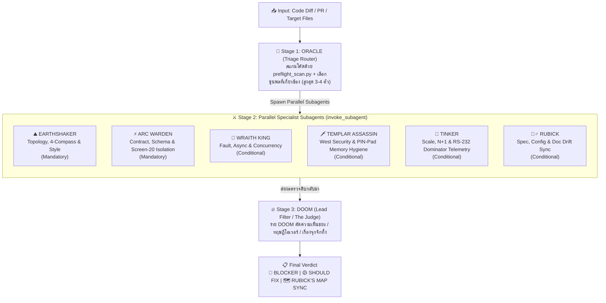
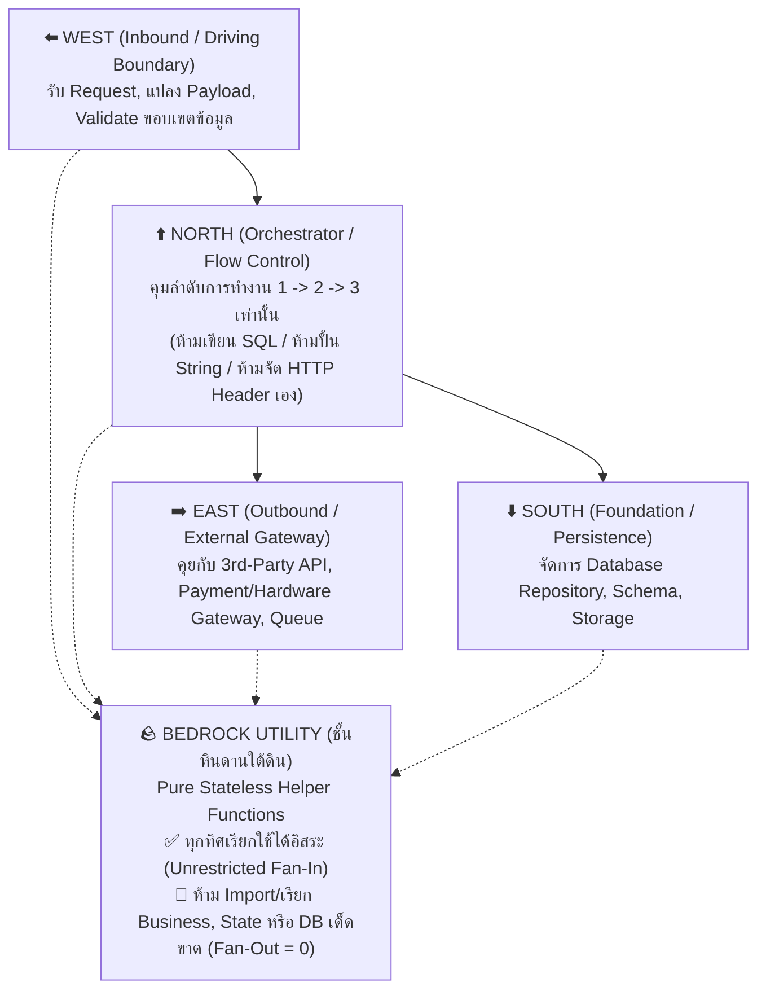

# 🏰 Defense of the Grid (`defense-of-the-grid`)

> **Multi-Agent Architecture Blueprint & Code Review Skill สำหรับ Google Antigravity**  
> ผสานปรัชญา **การวางผังเมืองและทฤษฎีกราฟ (City Planning & Graph Theory)** เข้ากับทีมผู้เชี่ยวชาญ **Dota 2 Multi-Agent Council** ที่รันแยกมิติแบบขนาน (Parallel Subagents) และคัดกรองความเห็นขยะทิ้งอย่างเด็ดขาด

---

## 🎯 ทำไมต้องมี Skill นี้?

ปัญหาคลาสสิกของการให้ AI รีวิวโค้ดหรือออกแบบระบบ คือ:
1. **ถ้าใช้ Agent ตัวเดียวดูทุกอย่าง:** มักจะหลุดรายละเอียดเชิงลึก หรือปนเปกันไปหมด
2. **ถ้าใช้หลาย Agents แต่ไม่มีตัวคุม:** แต่ละตัวจะพยายาม *"เค้นหาเรื่องมาติให้ได้"* จนเกิดความเห็นขยะ (Nitpicking), แนะนำ Design Pattern ท่ายากเกินความจำเป็น (Cargo-cult Over-engineering), หรือสร้างความกลัวเกินจริง (Hypothetical Ghost Stories)

**`defense-of-the-grid`** แก้ปัญหานี้ด้วยการวาง **กฎเหล็ก 7 ข้อแห่งป้อมปราการ (The Ancients)** และแบ่งการทำงานเป็น **2 โหมดหลัก** (`/blueprint` และ `/review`) โดยใช้ระบบ **3-Stage Multi-Agent Pipeline**:



---

## 📜 THE ANCIENTS — 7 กฎเหล็กแห่งป้อมปราการ

ทุก Agent ในระบบนี้ยึดถือปรัชญาการเขียนโค้ด 7 ข้อใน [`references/00-the-ancients-core-laws.md`](./references/00-the-ancients-core-laws.md) อย่างเคร่งครัด:

### 1. 🧭 The 4-Directional Compass (เข็มทิศผังเมือง 4 ทิศ)
ห้ามเทรวมโค้ดทุกอย่างลงใน `Service` ก้อนเดียว ต้องแบ่งโซนตามทิศทางของข้อมูล:



### 2. 🕸️ Strict DAG & Dominator Nodes (เส้นกราฟห้ามกระโดดข้ามบล็อก)
* โครงสร้างการเรียกฟังก์ชันต้องเป็น **Directed Acyclic Graph (DAG)** ห้ามเกิด Circular Dependency (`A -> B -> A`)
* **เคารพ Dominator Node:** บล็อกชั้นบนห้ามแอบลัดวงจรข้ามบล็อกควบคุมตรงกลางไปเรียกชั้นล่างโดยตรง เพื่อให้มีจุดดัก Log, แทรก Policy, และทำ Mock ได้ที่คอขวดเดียวเสมอ

### 3. 🪨 The Bedrock Utility Exception (ข้อยกเว้นชั้นหินดาน)
* ฟังก์ชันช่วยเหลือที่เป็น Pure Stateless ให้อยู่ในชั้น **Bedrock Utility** (`util/`, `common/`)
* **Unrestricted Fan-In:** อนุญาตให้ทุกทิศ (North, West, East, South) เรียกใช้ Bedrock Utility ได้โดยตรงโดยไม่ถือว่าผิดกฎข้อ 2
* **Zero Fan-Out (`Fan-Out = 0`):** ห้ามไฟล์ใน Utility เรียกใช้หรือ Import `Service`, `Controller`, `Repository`, หรือ `State` ใดๆ เด็ดขาด

### 4. 🧪 Screen-20 Isolation & Explicit `self` (การตัดตอนรันแยกเดี่ยว)
* เหมือนการส่ง `struct *self` ในภาษา C หรือการแยกร่างของ Arc Warden — ทุกโมดูลหรือหน้าจอต้องรับ State ที่ต้องใช้เข้ามาอย่างชัดเจนที่ปากทางเข้า
* **ห้ามผูกติดลำดับก่อนหน้า (No Sequential Coupling):** นักพัฒนาหรือ Test Runner ต้องสามารถกระโดดเข้ามาที่ **หน้าจอที่ 20 (Node 20)** แล้วโยน Mock State เข้าไปรันหรือทำ TDD แยกเดี่ยวได้ทันที โดยไม่ต้องรันหน้าจอ 1 ถึง 19 มาก่อน

### 5. ✂️ The 3-Word Naming Rule (ตั้งชื่อไม่เกิน 3 คำ)
* ชื่อฟังก์ชัน เมธอด และตัวแปร ต้องสื่อความหมายจบภายใน **ไม่เกิน 3 คำหลัก** (เน้น `snake_case` เพื่อให้อ่านกวาดตาง่าย หรือตาม Idiom ของภาษา โดยไม่นับ Prefix มาตรฐานอย่าง `get_`, `is_`, `on_`)
* ถ้าตั้งชื่อใน 3 คำไม่ได้ แปลว่าฟังก์ชันนั้นทำหลายอย่างเกินไป หรือวางผิดทิศ — ให้แยกส่วนหรือย้ายโซนทันที

### 6. 📝 Notepad++ Spatial Ergonomics (เรียงโค้ดบนลงล่าง & สมมาตร A-to-Z)
* **Top-Down Narrative Flow:** วาง Public Orchestrator Method ไว้บนสุดของไฟล์ แล้วเรียง Private Methods ลูกน้องข้างล่างตามลำดับที่ถูกเรียก `1 -> 2 -> 3` เป๊ะๆ เพื่อให้อ่านไหลจากบนลงล่างได้ในโปรแกรมแก้ไขข้อความธรรมดาโดยไม่ต้องไถจอขึ้นลง
* **Cross-Layer A-to-Z Symmetry:** เมื่อชั้นบนส่งหรือจับคู่ข้อมูล `A` ถึง `Z` ลงไปชั้นล่าง ชั้นล่างต้องประกาศและรับมือเรียงลำดับ `A` ถึง `Z` แบบเดียวกันเป๊ะ เพื่อให้มองเห็นตัวที่ตกหล่นได้ด้วยตาเปล่าทันที

### 7. 🦎 Git-Blame Camouflage (การพรางตัวกลืนกับโค้ดเดิม)
* โค้ดที่เพิ่มหรือแก้ในไฟล์เดิม ต้องใช้คลังคำศัพท์ ระดับความละเอียด (Granularity) และจังหวะการดัก Error เหมือนเมธอดข้างเคียงทุกประการ จนคนอ่านไม่ออกว่าบรรทัดไหนเพิ่งเขียนเติมเข้ามาโดยไม่เปิด `git blame`

---

## ⚔️ ทำเนียบขุนพล (Hero Roster)

| ลำดับ | Hero | บทบาท | เงื่อนไขการอัญเชิญ | คัมภีร์อ้างอิง |
| :--- | :--- | :--- | :--- | :--- |
| **Stage 1** | 🔮 **ORACLE** | **Triage Router** | รันทุกครั้งเพื่อสแกน Diff + รัน `preflight_scan.py` และเลือกขุนพลเข้าทีม (สูงสุด 3–4 ตัว) | [`01-oracle-triage-router.md`](./references/01-oracle-triage-router.md) |
| **Stage 2** | ⛰️ **EARTHSHAKER** | **Topology & Style** | **บังคับลงสนามทุกครั้ง (Baseline)** — ตรวจผังเมือง 4 ทิศ, Dominator DAG, กฎชื่อ 3 คำ, เรียงโค้ด Notepad++, พรางตัว Git | [`02-earthshaker-topology-style.md`](./references/02-earthshaker-topology-style.md) |
| **Stage 2** | ⚡ **ARC WARDEN** | **Contract & State** | **บังคับลงสนามทุกครั้ง (Baseline)** — ตรวจ Business Logic, Schema/TLV, และกฎ **Screen-20 Isolation** | [`03-arc-warden-contract-state.md`](./references/03-arc-warden-contract-state.md) |
| **Stage 2** | 👑 **WRAITH KING** | **Fault & Concurrency** | เรียกเมื่อแตะ `async/await`, Thread, Queue, DB Transaction, Batch/Retry หรือยิง API ขาออก (East) | [`04-wraith-king-fault-concurrency.md`](./references/04-wraith-king-fault-concurrency.md) |
| **Stage 2** | 🗡️ **TEMPLAR ASSASSIN** | **Security & Hygiene** | เรียกเมื่อแตะ Inbound Route (West), Auth/Permission, SQL/OS Command, หรือข้อมูลลับ (PIN, Key, Token, PII) | [`05-templar-security-hygiene.md`](./references/05-templar-security-hygiene.md) |
| **Stage 2** | 🚀 **TINKER** | **Scale & Traceability** | เรียกเมื่อแตะ DB Query, Loop ข้อมูลชุดใหญ่, Stream/Batch หรือจุดตัด Dominator ที่ต้องมี Log ตามรอยบน Prod (RS-232 Telemetry) | [`06-tinker-scale-trace.md`](./references/06-tinker-scale-trace.md) |
| **Stage 2** | 🧙‍♂️ **RUBICK** | **Spec & Doc Sync** | เรียกเมื่อแก้ API Route/DTO, DB Schema, Env/Config หรือ Flow หลัก (รันคู่กับ `doc_drift_finder.py` และห้ามสั่งเขียน Comment ซ้ำซ้อน) | [`07-rubick-spec-doc-sync.md`](./references/07-rubick-spec-doc-sync.md) |
| **Stage 3** | 🔥 **DOOM** | **Lead Filter (Judge)** | รันปิดท้ายทุกครั้ง — ร่าย **DOOM Silence Filter** ลบความเห็นขยะ, ทฤษฎี Cargo-cult, เรื่องมโนเกินจริง และยุบรวมประเด็นซ้ำ | [`08-doom-lead-filter.md`](./references/08-doom-lead-filter.md) |

---

## 📂 โครงสร้างไฟล์ใน Repository

```text
defense-of-the-grid/
├── SKILL.md                                      # ไฟล์คำสั่งหลักสำหรับ Antigravity Agent
├── README.md                                     # เอกสารคู่มือการใช้งานสำหรับมนุษย์ (ไฟล์นี้)
├── references/                                   # คัมภีร์แยกตามบทบาท (Progressive Disclosure)
│   ├── 00-the-ancients-core-laws.md              # กฎเหล็ก 7 ข้อแห่งป้อมปราการ
│   ├── 01-oracle-triage-router.md                # Stage 1: กฎการคัดกรองและเลือกขุนพล
│   ├── 02-earthshaker-topology-style.md          # Stage 2: โครงสร้างกราฟ ผังเมือง 4 ทิศ และการจัดวางโค้ด
│   ├── 03-arc-warden-contract-state.md           # Stage 2: ความถูกต้องของข้อมูลและ Screen-20 Isolation
│   ├── 04-wraith-king-fault-concurrency.md       # Stage 2: ความทนทานต่อการล่มและ Async/Concurrency
│   ├── 05-templar-security-hygiene.md            # Stage 2: ความปลอดภัยขอบเขต West และ PIN-Pad Memory Hygiene
│   ├── 06-tinker-scale-trace.md                  # Stage 2: ประสิทธิภาพและ RS-232 Dominator Telemetry
│   ├── 07-rubick-spec-doc-sync.md                # Stage 2: การซิงค์เอกสาร Spec/Config และกฎ Anti-SA Comment
│   └── 08-doom-lead-filter.md                    # Stage 3: กฎการปัดตกความเห็นขยะและฟอร์แมตสรุปผล
└── scripts/                                      # สคริปต์ช่วยสแกนอัตโนมัติ
    ├── preflight_scan.py                         # ตรวจจับชื่อฟังก์ชันเกิน 3 คำ และ Utility Fan-Out > 0
    └── doc_drift_finder.py                       # กวาดหาไฟล์ Spec/Doc/Config ในโปรเจกต์ให้ RUBICK
```

---

## 🚀 วิธีติดตั้ง (Installation)

สามารถเลือกติดตั้งได้ 2 แบบตามความต้องการ:

### แบบที่ 1: ติดตั้งระดับ Global (ใช้ได้กับทุกโปรเจกต์ในเครื่อง)
ทำ Symlink ไปยังโฟลเดอร์ Global Skills ของ Antigravity:

```bash
mkdir -p ~/.gemini/config/skills
ln -sfn /path/to/defense-of-the-grid ~/.gemini/config/skills/defense-of-the-grid
```

### แบบที่ 2: ติดตั้งเฉพาะโปรเจกต์ (Workspace-Specific)
ทำ Symlink หรือใส่เป็น Git Submodule ไว้ในโฟลเดอร์ `.agents/skills/` ของโปรเจกต์ปลายทาง:

```bash
cd /path/to/your-project
mkdir -p .agents/skills
ln -sfn /path/to/defense-of-the-grid .agents/skills/defense-of-the-grid
```

---

## 💡 วิธีเรียกใช้งาน (Usage)

เมื่อติดตั้งเสร็จแล้ว สามารถสั่งงานในแชทของ Antigravity ได้ทั้ง 2 โหมด:

### 1. โหมดวางผังเมืองก่อนเขียนโค้ด (`/blueprint`)
> *"ช่วยวาง `/blueprint` ตามกฎ `defense-of-the-grid` สำหรับฟีเจอร์ตัดเงินและออกใบกำกับภาษีหน่อย"*

Agent จะ:
* แยกส่วนประกอบลง **เข็มทิศ 4 ทิศ** (`North`, `West`, `East`, `South` + `Bedrock Utility`)
* เสนอชื่อฟังก์ชันตาม **กฎ 3 คำ** เรียงลำดับบนลงล่างแบบ **Top-Down Narrative**
* ระบุสัญญา **Screen-20 Isolation Contract** เพื่อให้เขียนเทสต์แยกเดี่ยวได้ทันทีก่อนเริ่มลงมือเขียนโค้ดจริง

### 2. โหมดตรวจรับและรีวิวโค้ด (`/review`)
> *"ช่วย `/review` โค้ดที่แก้ใน `git diff` (หรือไฟล์ `src/...`) ด้วย `defense-of-the-grid` ให้หน่อย"*

Agent จะ:
1. ให้ **`ORACLE`** รัน [`scripts/preflight_scan.py`](./scripts/preflight_scan.py) และประกาศรายชื่อขุนพลที่ถูกอัญเชิญ
2. แตก **Parallel Subagents (`invoke_subagent`)** ออกไปตรวจพร้อมกันเฉพาะมุมที่เกี่ยวข้อง
3. ให้ **`DOOM`** รวบรวมผล ปัดตกความเห็นขยะ และสรุปเฉพาะประเด็นสำคัญเป็น:
   * 🔴 **BLOCKER** (ต้องแก้ก่อนขึ้นระบบ)
   * 🟡 **SHOULD FIX** (ควรเกลาตามผังเมืองและปรัชญาโค้ด)
   * 🗺️ **RUBICK'S MAP SYNC** (รายการไฟล์ Spec/Config/Doc ที่ต้องอัปเดตตาม)
