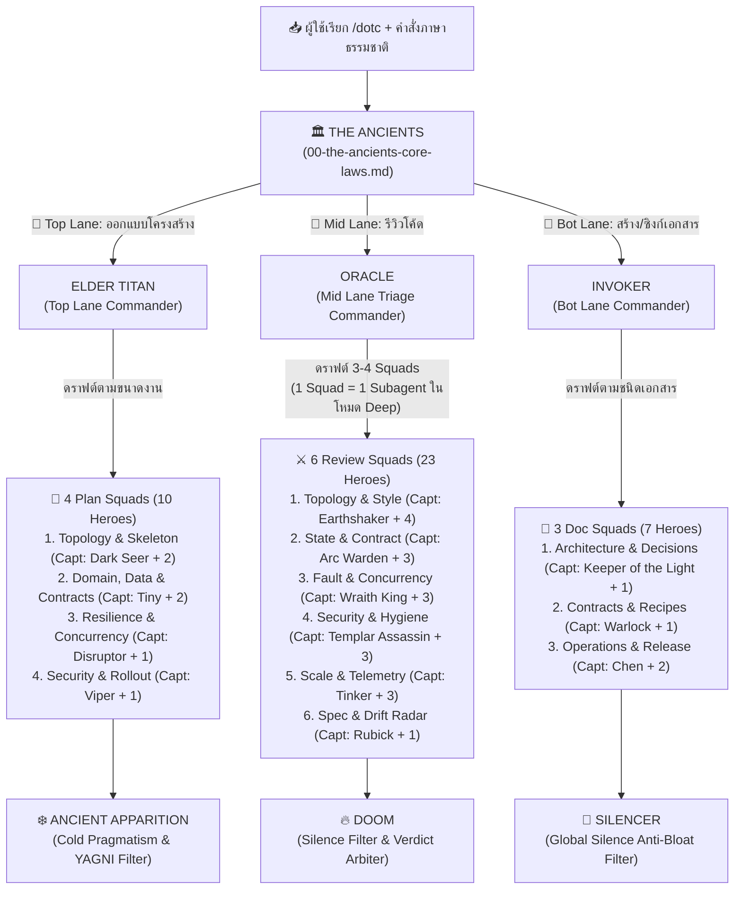

# 🏰 Defense of the Code (`defense-of-the-code`)

> **3-Lane Multi-Commander & Squad Software Architecture, Code Review & Documentation Skill สำหรับ Google Antigravity**  
> ดำเนินการภายใต้ปรัชญา **ทางสายกลาง (The Middle Path — Proportional Complexity)** ผสานหลัก **ทฤษฎีกราฟ การแยกส่วนโมดูลเชิงตั้งฉาก และการตัดตอนสถานะ (Graph Topology, Orthogonal Decomposition & State Isolation)** เข้ากับระบบ **3-Lane Multi-Commander & Squad Progressive Disclosure (`1 Hero = 1 File`)** ที่แบ่งแผนที่ออกเป็น **3 เลนหลัก (🔨 Top Lane: Plan / 🔮 Mid Lane: Review / 📖 Bot Lane: Doc)** รวม **13 Squads, 46 ฮีโร่ไม่ซ้ำกัน**

---

## 🎯 แนวคิดการออกแบบ (Symmetrical 3-Lane Multi-Squad Pipeline)

ปัญหาคลาสสิกของการใช้ AI ช่วยออกแบบระบบ รีวิวโค้ด หรือเขียนเอกสาร คือ:
1. **ถ้ายัดทุกกฎใส่ Prompt เดียวตลอดเวลา:** Context บวม เปลือง Token และ AI โฟกัสหลุด
2. **ถ้าซอย Subagent แยกทุกกฎย่อย:** เวลาตรวจโค้ดรอบนึงต้องแตก 15–20 Subagent เปลืองค่าอ่าน Diff ซ้ำซ้อน
3. **ถ้าปนบทบาทคนตรวจโค้ด (Read-only) กับคนเขียนเอกสาร (Writer):** คำสั่งในไฟล์เดียวกันตีกันเอง
4. **ถ้าไม่มีตัวกรองขั้นสุดท้าย:** AI มักเค้นหาเรื่องจุกจิกมาติ (Nitpicking), แนะนำท่ายากเกินความจำเป็น (YAGNI), หรือเขียนเอกสารน้ำท่วมทุ่ง

**`defense-of-the-code` (v2.1)** จึงจัดโครงสร้างแบบ **Symmetrical 3-Stage Squad Pipeline** ในทั้ง **3 Lanes**:
> **Stage 1 · Draft — แม่ทัพประจำเลน (Lane Commander) $\rightarrow$ Stage 2 · Teamfight — หน่วยรบผู้เชี่ยวชาญเฉพาะทาง (`13 Squads`, `1 Hero = 1 File`) $\rightarrow$ Stage 3 · Deny — ผู้กรองปิดท้าย (Final Filter)**



---

## 📜 THE ANCIENTS — 7 หลักการสถาปัตยกรรมและวิศวกรรมซอฟต์แวร์

รายละเอียดฉบับเต็มอยู่ใน [`references/00-the-ancients-core-laws.md`](./references/00-the-ancients-core-laws.md):

1. **🧭 Law 1 — Orthogonal Decomposition (4-Axis + Core & Brownfield Constructor Guard):** แยกส่วนรับผิดชอบออกเป็นแกนหน้าที่ที่ตั้งฉากกัน (ไม่เกิน 4 แกนรอบข้าง + 1 แกนกลาง) และเมื่อต่อเติมระบบเดิม (เช่น Guice `@Inject()` ใน Scala Play) ให้เพิ่มเมธอดใน Collaborator เดิมในแกนที่ตรงกันเพื่อไม่ให้ Constructor เปลี่ยนจน Unit Test (`*Spec`) พังทั้งระบบ
2. **🕸️ Law 2 — Acyclic Call Topology & Dominator Enforcement (Strict DAG & Envelope Adaptability):** ห้ามเกิด Circular Dependency (`A -> B -> A`), ห้ามลัดวงจรข้าม Dominator Gatekeeper, และหาก Dominator ดูแลหลาย API Version ต้องแยกการตรวจสิทธิ์ออกจากการจัด Format Error (ห้ามทำ Modern Error Envelope รั่วไหลใส่ Legacy Route)
3. **🪨 Law 3 — Leaf-Node Pure Utilities (`Fan-Out = 0` Invariant):** ฟังก์ชันใน `util/` หรือ `common/` ต้องไร้สถานะ 100% ทุกชั้นเรียกใช้ได้อิสระ (`Unrestricted Fan-In`) แต่ห้าม Import หรือเรียก Service, Controller หรือ Repository เด็ดขาด (`Out-Degree = 0`)
4. **🧪 Law 4 — Subgraph State Isolation & Explicit Context Injection:** ทุกคอมโพเนนต์ต้องรับ State Context เข้ามาอย่างชัดเจนที่อินเทอร์เฟซขาเข้า เพื่อให้ตัดโหนดที่ $N$ ออกมาเขียน Unit Test หรือรันแยกเดี่ยวได้โดยไม่ต้องรันขั้นตอนที่ `1..N-1`
5. **✂️ Law 5 — Lexical Conciseness (~2–3 Lexemes) & Idiomatic Casing Hierarchy:** ตั้งชื่อให้กระชับภายใน ~2–3 คำหลัก (ใช้เป็นตัวตรวจจับกลิ่น SRP) และยึดลำดับตัวอักษรตาม **(1) สไตล์เดิมของไฟล์นั้น $\rightarrow$ (2) มาตรฐานของภาษา $\rightarrow$ (3) `snake_case`**
6. **📝 Law 6 — Linear Execution Ordering (Stepdown Rule) & Structural Symmetry:** เรียงเมธอดที่เขียนใหม่จาก `public` ลงมา `private` (`1 -> 2 -> 3`) และเรียงฟิลด์ใน Type ที่สร้างใหม่ให้สมมาตรกันข้ามเลเยอร์ (**ห้ามสั่งสลับลำดับเมธอดเดิมหรือฟิลด์ของ `case class`/DTO เดิมในไฟล์เก่า**)
7. **🦎 Law 7 — Contextual Stylistic Homogeneity & Surgical Edits:** โค้ดที่แก้ในไฟล์เดิมต้องกลมกลืนกับเมธอดรอบข้าง และแก้เฉพาะจุดแบบ Surgical Edit

---

## ⚔️ ทำเนียบแม่ทัพและทีมฮีโร่ทั้ง 3 Lanes (`13 Squads`, `46 Heroes`, `1 Hero = 1 File`)

### 🔨 Top Lane: Architectural Blueprint (ออกแบบและวางแผนก่อนเขียนโค้ด — 4 Plan Squads, 10 Heroes)
- **แม่ทัพเปิดเลน (Stage 1 · Draft):** 🔨 **`ELDER TITAN`** ([`top-lane-elder-titan.md`](./references/commanders/top-lane-elder-titan.md))
- **ผู้กรองแผนปิดท้าย (Stage 3 · Deny):** ❄️ **`ANCIENT APPARITION`** ([`top-lane-ancient-apparition.md`](./references/commanders/top-lane-ancient-apparition.md))

| Plan Squad (`plan-squads/`) | กัปตันทีม (Captain) | ลูกทีมในสังกัด (`1 Hero = 1 File`) |
| :--- | :--- | :--- |
| **1. Topology & Skeleton** (`squad-1-topology/`) | 🌀 **DARK SEER** *(4-Axis, DAG & Leaf Utilities)* | • ⚓ **KUNKKA** *(Linear Stepdown Skeleton & ~2–3 Lexemes)*<br>• 🌳 **TREANT PROTECTOR** *(Brownfield Surgical Plan & `*Spec` Guard)* |
| **2. Domain, Data & Contracts** (`squad-2-domain/`) | 🪨 **TINY** *(Schema-First & Field Symmetry)* | • 🌌 **ENIGMA** *(Subgraph State Isolation & Unit-Test Contract)*<br>• 🐻 **LONE DRUID** *(Dual-Stack Wire Contracts & Error Envelopes)* |
| **3. Resilience & Concurrency** (`squad-3-resilience/`) | ⛈️ **DISRUPTOR** *(Failure Modes, Timeouts & Retries)* | • 🐎 **CHAOS KNIGHT** *(Multi-Instance Safety, Idempotency & Locking)* |
| **4. Security & Rollout** (`squad-4-rollout/`) | 🧪 **VIPER** *(AuthN/AuthZ Scope Matrix & PII Redaction)* | • 🕳️ **UNDERLORD** *(Expand-Contract DB Migration & Rollout Sequence)* |

---

### 🔮 Mid Lane: Progressive Code Review (ตรวจโค้ด 3 ด่าน Read-Only — 6 Review Squads, 23 Heroes)
- **แม่ทัพคัดกรอง (Stage 1 · Draft):** 🔮 **`ORACLE`** ([`mid-lane-oracle.md`](./references/commanders/mid-lane-oracle.md)) — รัน `preflight_scan.py` และดราฟต์ **3–4 Squads** (พร้อมคัดเฉพาะฮีโร่ที่เกี่ยวข้องในแต่ละทีม)
- **ผู้ตัดสินปิดท้าย (Stage 3 · Deny):** 🔥 **`DOOM`** ([`mid-lane-doom.md`](./references/commanders/mid-lane-doom.md)) — ตัด Nitpick, YAGNI และ High-Churn Brownfield Demands ทิ้ง

| Review Squad (1 Squad = 1 Subagent ในโหมด Deep) | กัปตันทีม (Captain) | ลูกทีมในสังกัด (`1 Hero = 1 File`) |
| :--- | :--- | :--- |
| **1. Topology & Style** (`squad-1-topology/`) | ⛰️ **EARTHSHAKER** *(4-Axis, DAG & Polymorphic Gate)* | • 🪚 **TIMBERSAW** *(Leaf Utility `Fan-Out = 0`)*<br>• 🦏 **MAGNUS** *(Stepdown & Symmetry)*<br>• 🗡️ **SVEN** *(~2–3 Lexeme Naming & Casing)*<br>• 🌊 **MORPHLING** *(Brownfield Guard & Style)* |
| **2. State & Contract** (`squad-2-state/`) | ⚡ **ARC WARDEN** *(State Isolation)* | • 🐍 **MEDUSA** *(Immutability & Domain Model)*<br>• ⏳ **FACELESS VOID** *(Boundary & Null/Option Safety)*<br>• 🍺 **BREWMASTER** *(Backward Compatibility & Legacy Error Envelope)* |
| **3. Fault & Concurrency** (`squad-3-fault/`) | 👑 **WRAITH KING** *(Fault & Atomicity)* | • 🪲 **WEAVER** *(Race Conditions, Async & Idempotency)*<br>• 🛡️ **ABADDON** *(Timeouts & Backpressure)*<br>• 🔥 **PHOENIX** *(Resource Lifecycle & Leak Prevention)* |
| **4. Security & Hygiene** (`squad-4-security/`) | 🌸 **TEMPLAR ASSASSIN** *(Ingress & Injection)* | • 🎯 **BOUNTY HUNTER** *(AuthN/AuthZ & IDOR)*<br>• 👹 **SHADOW FIEND** *(Secrets & PII Sink Masking)*<br>• 🦂 **NYX ASSASSIN** *(SSRF & Deserialization)* |
| **5. Scale & Telemetry** (`squad-5-scale/`) | 🚀 **TINKER** *(N+1 & Query Scale)* | • ⚙️ **CLOCKWERK** *(10s Triage Logs & Trace ID)*<br>• 🧪 **ALCHEMIST** *(Memory Footprint & Streaming)*<br>• 🚁 **GYROCOPTER** *(Pagination Caps & Cache Hygiene)* |
| **6. Spec & Drift Radar** (`squad-6-drift/`) | 🧙‍♂️ **RUBICK** *(Spec/Config Drift)* | • 🖌️ **GRIMSTROKE** *(Stale Comment Purge & High-Signal Why)* |

---

### 📖 Bot Lane: Documentation & Knowledge Sync (สร้างและอัปเดตเอกสารทางเทคนิค — 3 Doc Squads, 7 Heroes)
- **แม่ทัพเปิดเลน (Stage 1 · Draft):** 📖 **`INVOKER`** ([`bot-lane-invoker.md`](./references/commanders/bot-lane-invoker.md))
- **ผู้ตัดน้ำท่วมทุ่งปิดท้าย (Stage 3 · Deny):** 🤫 **`SILENCER`** ([`bot-lane-silencer.md`](./references/commanders/bot-lane-silencer.md)) — บังคับใช้ *Global Silence* ตัดเกริ่นนำขยะ เปลี่ยนข้อความยาวๆ เป็นตารางและไดอะแกรม Mermaid

| Doc Squad (`doc-squads/`) | กัปตันทีม (Captain) | ลูกทีมในสังกัด (`1 Hero = 1 File`) |
| :--- | :--- | :--- |
| **1. Architecture & Decisions** (`squad-1-architecture/`) | 💡 **KEEPER OF THE LIGHT** *(`ARCHITECTURE.md` & Mermaid Diagrams)* | • 🟣 **VOID SPIRIT** *(ADRs, RFC Rationales & High-Signal "Why" Comments)* |
| **2. Contracts & Recipes** (`squad-2-contracts/`) | 📕 **WARLOCK** *(API Contracts, Schemas & `.env.example`)* | • 🐍 **SHADOW SHAMAN** *(Consumer Cookbooks, Bruno/Postman & `cURL` Recipes)* |
| **3. Operations & Release** (`squad-3-operations/`) | 🦌 **CHEN** *(`README.md` & Developer Onboarding)* | • 🛡️ **OMNIKNIGHT** *(Operational Runbooks, Alert Triage & Incident SOPs)*<br>• ⚡ **ZEUS** *(PR Summaries, `CHANGELOG.md` & Migration Guides)* |

---

## 📂 โครงสร้างไฟล์ใน Repository

```text
defense-of-the-code/
├── SKILL.md                                      # ไฟล์คำสั่งหลักและ 3-Lane Intent Router (Top / Mid / Bot Lane)
├── plugin.json                                   # Plugin Manifest สำหรับ Antigravity
├── install.sh                                    # สคริปต์ติดตั้งและอัปเดตอัตโนมัติ
├── uninstall.sh                                  # สคริปต์ถอนการติดตั้ง
├── README.md                                     # เอกสารคู่มือการใช้งานฉบับเต็ม
├── scripts/
│   ├── preflight_scan.py                         # สแกน git diff, Cross-Version Hazards, Law 3 & Law 5 Hints
│   └── doc_candidate_finder.py                   # กวาดหาไฟล์ Spec/Doc/Config ในโปรเจกต์
└── references/
    ├── 00-the-ancients-core-laws.md              # กฎเหล็กสูงสุด 7 ข้อ (The Ancients)
    ├── commanders/                               # แม่ทัพเปิดเลน & ผู้กรองปิดท้ายของทั้ง 3 Lanes (6 Heroes)
    │   ├── top-lane-elder-titan.md
    │   ├── top-lane-ancient-apparition.md
    │   ├── mid-lane-oracle.md
    │   ├── mid-lane-doom.md
    │   ├── bot-lane-invoker.md
    │   └── bot-lane-silencer.md
    └── heroes/                                   # คลังฮีโร่ 13 Squads แยกไฟล์เดี่ยว (40 Squad Heroes)
        ├── plan-squads/                          # 🔨 Top Lane: 4 Plan Squads (10 Heroes)
        │   ├── squad-1-topology/                 #    Dark Seer, Kunkka, Treant Protector
        │   ├── squad-2-domain/                   #    Tiny, Enigma, Lone Druid
        │   ├── squad-3-resilience/               #    Disruptor, Chaos Knight
        │   └── squad-4-rollout/                  #    Viper, Underlord
        ├── review-squads/                        # 🔮 Mid Lane: 6 Review Squads (23 Heroes)
        │   ├── squad-1-topology/                 #    Earthshaker, Timbersaw, Magnus, Sven, Morphling
        │   ├── squad-2-state/                    #    Arc Warden, Medusa, Faceless Void, Brewmaster
        │   ├── squad-3-fault/                    #    Wraith King, Weaver, Abaddon, Phoenix
        │   ├── squad-4-security/                 #    Templar Assassin, Bounty Hunter, Shadow Fiend, Nyx Assassin
        │   ├── squad-5-scale/                    #    Tinker, Clockwerk, Alchemist, Gyrocopter
        │   └── squad-6-drift/                    #    Rubick, Grimstroke
        └── doc-squads/                           # 📖 Bot Lane: 3 Doc Squads (7 Heroes)
            ├── squad-1-architecture/             #    Keeper of the Light, Void Spirit
            ├── squad-2-contracts/                #    Warlock, Shadow Shaman
            └── squad-3-operations/               #    Chen, Omniknight, Zeus
```

---

## 💡 วิธีเรียกใช้งาน (Usage)

สามารถเรียก `/defense-of-the-code` (หรือพิมพ์ย่อ `/dotc`) ตามด้วยคำสั่งภาษาธรรมชาติได้ทันที:

```text
# 🔨 Top Lane: ออกแบบและวางแผนโครงสร้างโค้ด (ELDER TITAN -> 4 Plan Squads -> ANCIENT APPARITION)
/dotc ช่วยออกแบบฟีเจอร์คำนวณภาษีต่อจากที่คุยกันเมื่อกี้หน่อย
/blueprint

# 🔮 Mid Lane: รีวิวโค้ด (ORACLE -> 6 Review Squads -> DOOM)
/dotc รีวิวโค้ดที่เพิ่งแก้ให้หน่อย                        (⚡ Standard In-Context)
/dotc รีวิวละเอียดแบบเข้มๆ ขอ fresh eyes                 (🔬 Deep Parallel Squad Subagents)
/review
/review deep

# 📖 Bot Lane: สร้างและอัปเดตเอกสาร (INVOKER -> 3 Doc Squads -> SILENCER)
/dotc ช่วยวาด Mermaid diagram สรุป architecture ของโมดูลนี้ให้หน่อย
/dotc ช่วยเขียน Runbook สำหรับ triage error กับขั้นตอน rotate key
/dotc ช่วยสรุป PR description จาก branch นี้ให้ที
/doc
```
