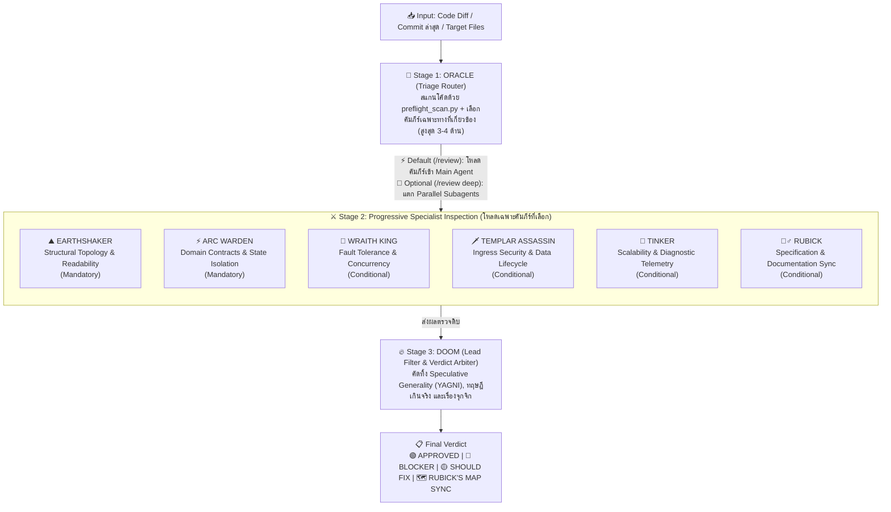
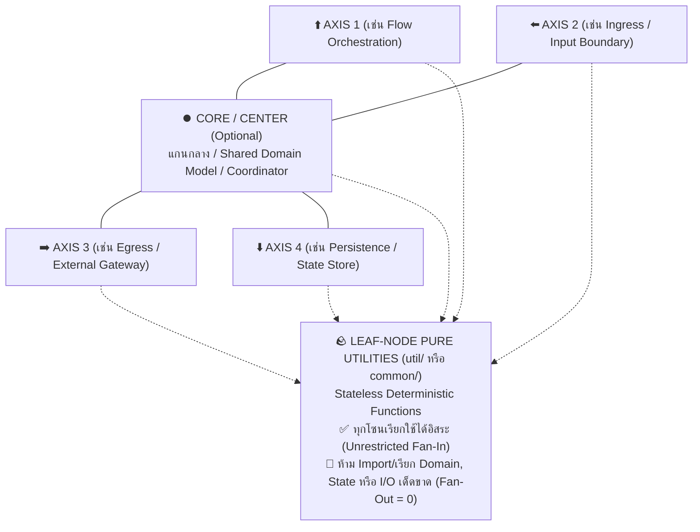

# 🏰 Defense of the Grid (`defense-of-the-grid`)

> **Progressive Software Architecture & Code Review Skill สำหรับ Google Antigravity**  
> ผสานหลัก **ทฤษฎีกราฟ การแยกส่วนโมดูลเชิงตั้งฉาก และการตัดตอนสถานะ (Graph Topology, Orthogonal Decomposition & State Isolation)** เข้ากับระบบ **Progressive Disclosure** ที่เลือกโหลดเฉพาะคัมภีร์ผู้เชี่ยวชาญที่เกี่ยวข้องและคัดกรองความเห็นขยะทิ้งอย่างเด็ดขาด

---

## 🎯 แนวคิดการออกแบบ (Build Skills, Not Agents)

ปัญหาคลาสสิกของการใช้ AI ช่วยออกแบบระบบหรือรีวิวโค้ด คือ:
1. **ถ้ายัดทุกกฎใส่ Prompt เดียวตลอดเวลา:** Context บวม เปลือง Token และ AI โฟกัสหลุด
2. **ถ้าสร้างแยกเป็นหลาย Custom Agents ถาวร:** คุยต่อกันไม่รู้เรื่อง บริบทตกหล่น (Context Loss) และเสียเวลาสลับตัว
3. **ถ้าไม่มีตัวกรองขั้นสุดท้าย:** AI มักพยายาม *"เค้นหาเรื่องมาติให้ได้"* จนเกิดความเห็นขยะ (Nitpicking), แนะนำ Design Pattern ท่ายากเกินความจำเป็น (Speculative Generality / YAGNI Violations), หรือยกกรณีสมมติที่ไม่มีโอกาสเกิดจริง

**`defense-of-the-grid`** ใช้สถาปัตยกรรม **3-Stage Progressive Pipeline**: ให้ Main Agent ตัวเดียวที่รู้บริบทงานครบ 100% ทำหน้าที่คัดกรอง (`ORACLE`), เลือกเปิดอ่านเฉพาะคัมภีร์เฉพาะทางที่เกี่ยวข้อง (`references/02..07`), และกรองความเห็นขยะทิ้ง (`DOOM`):



---

## 📜 THE ANCIENTS — 7 หลักการสถาปัตยกรรมและวิศวกรรมซอฟต์แวร์

รายละเอียดฉบับเต็มอยู่ใน [`references/00-the-ancients-core-laws.md`](./references/00-the-ancients-core-laws.md):

### 1. 🧭 Orthogonal Decomposition (4-Axis + Core Partitioning)
ห้ามเทรวมตรรกะทั้งหมดลงใน `Service` ก้อนเดียว (Monolithic Service) ให้แยกส่วนรับผิดชอบออกเป็นแกนหน้าที่ที่ตั้งฉากต่อกัน (**ไม่เกิน 4 แกนรอบข้าง + 1 แกนกลาง `Core/Center`** ตามแนวคิดปุ่มควบคุม D-Pad):
* **High Cohesion, Single Axis of Responsibility:** แต่ละแกนทำหน้าที่อะไรปรับเปลี่ยนได้ตามบริบทของโดเมนนั้นๆ (เช่น Flow Orchestration, Ingress, Egress, Persistence หรือแยกตาม Sub-domain)
* **Strict Boundary:** เมื่อแบ่งโซนแล้ว แต่ละโซนต้องทำงานอยู่ในระดับนามธรรม (Abstraction Level) ของตัวเอง ห้ามเขียนโค้ดข้ามบทบาทปนกัน



### 2. 🕸️ Acyclic Call Topology & Dominator Enforcement (Strict DAG)
* โครงสร้างการเรียกข้ามโมดูลต้องเป็น **Directed Acyclic Graph (DAG)** ห้ามเกิด Circular Dependency (`A -> B -> A`)
* **Dominator Vertex Enforcement:** โมดูลชั้นบนห้ามลัดวงจรข้ามชั้นควบคุมตรงกลาง (Dominator Node) ไปเรียกชั้นล่างโดยตรง เพื่อให้มีจุดศูนย์กลางเดียวสำหรับทำ Policy Enforcement, Instrumentation และ Test Doubles

### 3. 🪨 Leaf-Node Pure Utilities (`Fan-Out = 0` Invariant)
* ฟังก์ชันช่วยเหลือที่ไร้สถานะ (Pure Stateless Functions) ให้จัดไว้ในชั้น **Leaf Utility** (`util/`, `common/`)
* **Unrestricted Fan-In (`In-Degree ≥ 0`):** อนุญาตให้ทุกโซนเรียกใช้ Leaf Utility ได้โดยตรงโดยไม่ถือว่าผิดกฎข้อ 2
* **Zero Fan-Out (`Out-Degree = 0`):** ห้ามไฟล์ใน Utility เรียกใช้หรือ Import `Service`, `Controller`, `Repository`, หรือ `State` ใดๆ เด็ดขาด

### 4. 🧪 Subgraph State Isolation & Explicit Context Injection
* **Zero Sequential Coupling:** ห้ามโมดูลหรือหน้าจอใดๆ พึ่งพา Hidden Global State หรือผลข้างเคียงที่ถูกทิ้งไว้จากขั้นตอนก่อนหน้า (`Steps 1..N-1`)
* **Explicit Context Injection:** ทุกคอมโพเนนต์ต้องประกาศรับ State Context ที่ต้องใช้เข้ามาอย่างชัดเจนที่อินเทอร์เฟซขาเข้า เพื่อให้สามารถตัดโหนดที่ $N$ ออกมาเขียน Unit Test หรือรันแยกเดี่ยวได้ทันทีโดยไม่ต้องรันขั้นตอนที่ `1..N-1` นำมาก่อน

### 5. ✂️ Lexical Conciseness (~2–3 Lexemes) & Idiomatic Casing Hierarchy
* **ความกระชับของชื่อ (~2–3 คำหลัก):** ตั้งชื่อฟังก์ชัน เมธอด และตัวแปรให้สื่อความหมายจบภายในประมาณ 2–3 คำหลัก (ไม่นับ Prefix มาตรฐานอย่าง `get_`, `is_`, `on_`) โดยใช้เป็น **ตัวตรวจจับกลิ่นโค้ด (SRP Smell Detector)** ไม่ใช่การล็อกจำนวนคำตายตัว — ถ้าชื่อยาวเพราะฟังก์ชันทำหลายอย่างปนกันให้แยกฟังก์ชัน แต่ถ้าจำเป็นต้องใช้ 4 คำเพื่อความชัดเจนทางธุรกิจ (หรือชื่อ Unit Test) สามารถใช้ได้
* **ลำดับความสำคัญของรูปแบบตัวอักษร (Casing Precedence):**
  1. **Local Module Convention First (Law 7):** ยึดตามรูปแบบที่ใช้กันอยู่แล้วในไฟล์หรือโมดูลนั้นเป็นหลัก
  2. **Language / Ecosystem Idiom Second:** ยึดตามมาตรฐานของภาษานั้นๆ (เช่น `camelCase` ใน Java/TS/Dart/Go, `PascalCase` ใน C#, `snake_case` ใน Python/Rust/C/SQL)
  3. **Favor `snake_case` When Unconstrained:** เมื่อไม่มีข้อบังคับของภาษา ให้ใช้ `snake_case` เป็นค่าเริ่มต้นเพื่อความชัดเจนในการแยกคำ

### 6. 📝 Linear Execution Ordering (Stepdown Rule) & Structural Symmetry
* **Top-Down Stepdown Rule:** วาง Public Entry/Orchestrator Method ไว้บนสุดของไฟล์หรือคลาส แล้วเรียง Private Helper Methods ข้างล่างตามลำดับเวลาที่ถูกเรียก `1 -> 2 -> 3` เพื่อให้อ่านไล่จากบนลงล่างได้เป็นเส้นตรงโดยไม่ต้องกระโดดข้ามบรรทัด
* **Cross-Layer Structural Symmetry:** เมื่อชั้นบนส่งหรือ Map ข้อมูล `A..Z` ลงไปชั้นล่าง ชั้นล่างต้องประกาศและประมวลผล `A..Z` ในลำดับเดียวกันเป๊ะ เพื่อให้ตรวจพบฟิลด์ที่ตกหล่นได้ทันที

### 7. 🦎 Contextual Stylistic Homogeneity
* โค้ดที่เพิ่มหรือแก้ไขในไฟล์เดิม ต้องคงระดับนามธรรม (Abstraction Granularity) คลังคำศัพท์ และรูปแบบการจัดการ Error ให้เป็นเนื้อเดียวกับเมธอดรอบข้าง

---

## ⚔️ ทำเนียบมุมมองผู้เชี่ยวชาญ (Specialist Lenses)

| ขั้นตอน | รหัสผู้เชี่ยวชาญ | ขอบเขตการตรวจสอบ | เงื่อนไขการเปิดใช้ | เอกสารอ้างอิง |
| :--- | :--- | :--- | :--- | :--- |
| **Stage 1** | 🔮 **ORACLE** | **Triage Router** | รันทุกครั้งเพื่อสแกน Diff ด้วย `preflight_scan.py` และเลือกคัมภีร์ที่เกี่ยวข้อง (สูงสุด 3–4 ด้าน) | [`01-oracle-triage-router.md`](./references/01-oracle-triage-router.md) |
| **Stage 2** | ⛰️ **EARTHSHAKER** | **Structural Topology & Readability** | **บังคับใช้ทุกครั้ง (Baseline)** — ตรวจการแยกส่วนโมดูล, กราฟ DAG, Leaf Utility, ความกระชับของชื่อ, Stepdown Rule และความกลมกลืนของโค้ด | [`02-earthshaker-topology-style.md`](./references/02-earthshaker-topology-style.md) |
| **Stage 2** | ⚡ **ARC WARDEN** | **Domain Contracts & State Isolation** | **บังคับใช้ทุกครั้ง (Baseline)** — ตรวจความถูกต้องของตรรกะ, Schema-First Modeling และ **Subgraph State Isolation** | [`03-arc-warden-contract-state.md`](./references/03-arc-warden-contract-state.md) |
| **Stage 2** | 👑 **WRAITH KING** | **Fault Tolerance & Concurrency** | เปิดใช้เมื่อแตะ `async/await`, Thread, Queue, DB Transaction, Batch/Retry หรือ External I/O | [`04-wraith-king-fault-concurrency.md`](./references/04-wraith-king-fault-concurrency.md) |
| **Stage 2** | 🗡️ **TEMPLAR ASSASSIN** | **Ingress Security & Data Lifecycle** | เปิดใช้เมื่อแตะ Ingress Controller, AuthN/AuthZ, Raw Query/Command หรือข้อมูลลับ (PIN, Key, Token, PII) | [`05-templar-security-hygiene.md`](./references/05-templar-security-hygiene.md) |
| **Stage 2** | 🚀 **TINKER** | **Scalability & Diagnostic Telemetry** | เปิดใช้เมื่อแตะ DB Query, Loop ข้อมูลชุดใหญ่, Stream/Batch หรือจุดตัดเลเยอร์ที่ต้องมี Structured Log สำหรับวิเคราะห์ปัญหาบน Production | [`06-tinker-scale-trace.md`](./references/06-tinker-scale-trace.md) |
| **Stage 2** | 🧙‍♂️ **RUBICK** | **Specification & Documentation Sync** | เปิดใช้เมื่อแก้ API Schema/DTO, DB Migration, Env/Config หรือ Flow หลัก (รันคู่กับ `doc_drift_finder.py`) | [`07-rubick-spec-doc-sync.md`](./references/07-rubick-spec-doc-sync.md) |
| **Stage 3** | 🔥 **DOOM** | **Lead Filter & Verdict Arbiter** | รันปิดท้ายทุกครั้ง — ตัดความเห็นขยะ, Speculative Generality (YAGNI), กรณีสมมติเกินจริง และยุบรวมประเด็นซ้ำ | [`08-doom-lead-filter.md`](./references/08-doom-lead-filter.md) |

---

## 📂 โครงสร้างไฟล์ใน Repository

```text
defense-of-the-grid/
├── SKILL.md                                      # ไฟล์คำสั่งหลักสำหรับ Antigravity Agent
├── README.md                                     # เอกสารคู่มือการใช้งานสำหรับมนุษย์ (ไฟล์นี้)
├── references/                                   # คัมภีร์แยกตามบทบาท (Progressive Disclosure)
│   ├── 00-the-ancients-core-laws.md              # หลักการสถาปัตยกรรมและวิศวกรรมซอฟต์แวร์ 7 ข้อ
│   ├── 01-oracle-triage-router.md                # Stage 1: เกณฑ์การคัดกรองและเลือกคัมภีร์เฉพาะทาง
│   ├── 02-earthshaker-topology-style.md          # Stage 2: โครงสร้างกราฟ การแยกโมดูล และการจัดลำดับโค้ด
│   ├── 03-arc-warden-contract-state.md           # Stage 2: ความถูกต้องของข้อมูลและ Subgraph State Isolation
│   ├── 04-wraith-king-fault-concurrency.md       # Stage 2: ความทนทานต่อความล้มเหลวและ Concurrency
│   ├── 05-templar-security-hygiene.md            # Stage 2: ความปลอดภัยขาเข้าและวงจรชีวิตข้อมูลสำคัญ
│   ├── 06-tinker-scale-trace.md                  # Stage 2: ประสิทธิภาพและ Diagnostic Telemetry
│   ├── 07-rubick-spec-doc-sync.md                # Stage 2: การซิงค์เอกสาร Spec/Config และ High-Signal Comments
│   └── 08-doom-lead-filter.md                    # Stage 3: กฎการกรองความเห็นขยะและฟอร์แมตสรุปผล
└── scripts/                                      # สคริปต์ช่วยสแกนอัตโนมัติ
    ├── preflight_scan.py                         # ตรวจจับชื่อฟังก์ชันยาวเกินเกณฑ์และ Leaf Utility Fan-Out > 0
    └── doc_drift_finder.py                       # กวาดหาไฟล์ Spec/Doc/Config ในโปรเจกต์ให้ RUBICK
```

---

## 🚀 วิธีติดตั้งและถอนการติดตั้ง (Installation & Uninstallation)

สามารถเลือกติดตั้งได้ 2 รูปแบบ:

### รูปแบบที่ 1: ติดตั้งระดับ Global (ใช้ได้กับทุกโปรเจกต์ในเครื่อง)

* **ติดตั้ง (สร้าง Symlink ไปยัง Global Skills ของ Antigravity):**
  ```bash
  mkdir -p ~/.gemini/config/skills
  ln -sfn /path/to/defense-of-the-grid ~/.gemini/config/skills/defense-of-the-grid
  ```
* **ถอนการติดตั้ง (ลบเฉพาะตัวเชื่อม Symlink โดยที่ไฟล์ใน Repo ต้นทางยังอยู่ครบ):**
  ```bash
  rm ~/.gemini/config/skills/defense-of-the-grid
  ```
  *(ใช้ `rm` ธรรมดาเท่านั้น ห้ามใส่ `/` ต่อท้ายหรือใช้ `rm -rf .../defense-of-the-grid/` เพราะจะลบไฟล์ใน Repo ต้นทางผ่าน Symlink)*

### รูปแบบที่ 2: ติดตั้งเฉพาะโปรเจกต์ (Workspace-Specific)

* **ติดตั้ง (สร้าง Symlink หรือวางไว้ใน `.agents/skills/` ของโปรเจกต์ปลายทาง):**
  ```bash
  cd /path/to/your-project
  mkdir -p .agents/skills
  ln -sfn /path/to/defense-of-the-grid .agents/skills/defense-of-the-grid
  ```
* **ถอนการติดตั้งออกจากโปรเจกต์:**
  ```bash
  cd /path/to/your-project
  rm .agents/skills/defense-of-the-grid          # กรณีติดตั้งแบบ Symlink
  # rm -rf .agents/skills/defense-of-the-grid    # กรณีคัดลอกโฟลเดอร์มาวางจริง (ไม่ใช่ Symlink) เท่านั้น
  ```
  *(หากติดตั้งไว้เป็น Git Submodule ให้รัน `git submodule deinit -f .agents/skills/defense-of-the-grid && git rm -f .agents/skills/defense-of-the-grid`)*

---

## 💡 วิธีเรียกใช้งาน (Usage)

### 1. โหมดวางโครงสร้างสถาปัตยกรรมก่อนเขียนโค้ด (`/blueprint`)
> *"ช่วยวาง `/blueprint` สำหรับฟีเจอร์ตัดเงินและออกใบกำกับภาษีหน่อย"*

Agent จะนำเสนอโครงสร้าง 3 ส่วนก่อนเริ่มเขียนโค้ดจริง:
* **🧭 Orthogonal Module Partitioning:** แยกความรับผิดชอบออกเป็นแกนหน้าที่ (`4-Axis + Core` และ `Leaf-Node Utilities`)
* **📝 Linear Stepdown Skeleton:** โครงเมธอดเรียงจากบนลงล่าง `1 -> 2 -> 3` ด้วยชื่อที่กระชับตามลำดับศักดิ์ของภาษา
* **🧪 Subgraph State Isolation Contract:** ระบุ State Context ที่ต้องรับเข้ามาเพื่อให้ทดสอบโหนดนี้แยกเดี่ยวได้ทันที

### 2. โหมดตรวจรีวิวโค้ด (`/review` และ `/review deep`)
* **รีวิวมาตรฐาน (เร็วและคงบริบทการสนทนาครบ 100%):**
  > *"ช่วย `/review` โค้ดที่แก้ล่าสุด (หรือไฟล์ `src/...`) ให้หน่อย"*
  * **`ORACLE`** รัน [`scripts/preflight_scan.py`](./scripts/preflight_scan.py) และเลือกคัมภีร์ที่เกี่ยวข้อง (สูงสุด 3–4 ด้าน)
  * **Main Agent** เปิดอ่านเฉพาะไฟล์ `references/` ที่ถูกเลือกขึ้นมาตรวจสอบและกรองผลผ่าน **`DOOM`**
* **รีวิวแบบแยก Subagent อิสระ (`/review deep`):**
  > *"ช่วย `/review deep` รอบนี้ให้หน่อย"*
  * แตก **Parallel Subagents (`invoke_subagent`)** แยกห้องตรวจเพื่อรับมุมมองที่เป็นอิสระจากโค้ดที่เพิ่งเขียน
